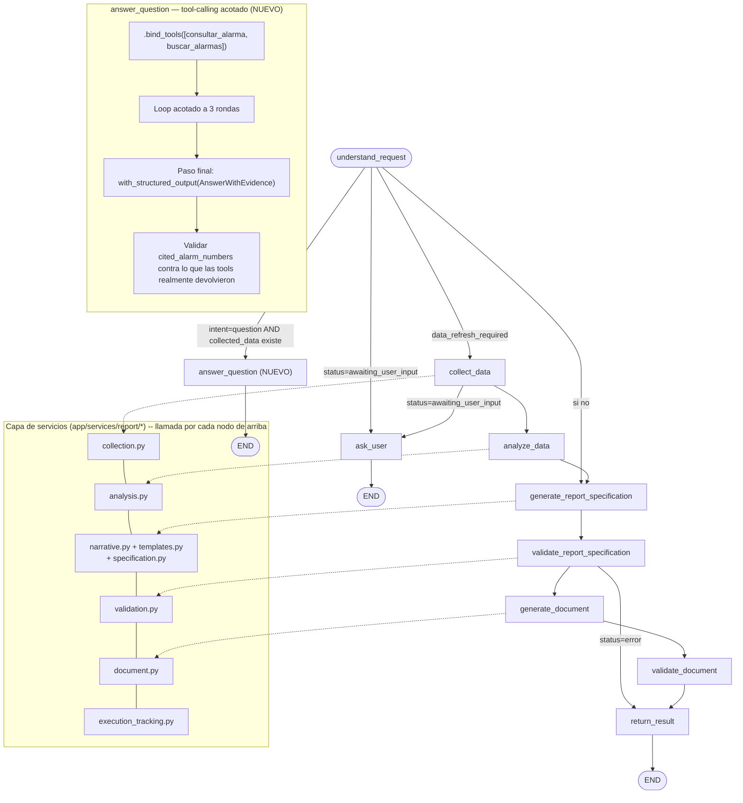

# AGENT_ARCHITECTURE.md — Fase 4: Refactorización y evolución del agente LangGraph

> Basado en [ARCHITECTURE_ASSESSMENT.md](ARCHITECTURE_ASSESSMENT.md) (Fase 0),
> [ARCHITECTURE_TARGET.md](ARCHITECTURE_TARGET.md) (Fase 1) y [DATA_MODEL.md](DATA_MODEL.md)
> (Fase 2). Fase implementada de punta a punta (código + Supabase + pruebas), verificada en vivo
> contra la API real de Anthropic, el Excel real del cliente y Supabase — no solo con mocks.
> 75/75 tests pasan (53 antes de esta fase + 22 nuevos).

## 1. Arquitectura actual del agente (antes de esta fase)

Un único `StateGraph` de LangGraph, 9 nodos, cada uno con su lógica de negocio **escrita
directamente dentro del nodo** — `collect_data.py` contenía las llamadas a `security_tools`,
`generate_report_spec.py` contenía el armado completo de las 11 secciones más la llamada al LLM,
etc. Dos llamadas al LLM por turno como máximo (`understand_request` para extraer campos,
`generate_narrative` para redactar prosa), sin tool-calling real — las "herramientas" en
`security_tools.py` las invocaba el nodo `collect_data` en un orden fijo, nunca el modelo.

`understand_request` ya clasificaba `intent` (`new_report` / `modify_report` /
`clarification_answer` / `other`) pero **nunca lo guardaba en el estado ni lo usaba para enrutar**
— el enrutamiento (`_route_after_understanding`) solo miraba `status` y `data_refresh_required`.
Consecuencia concreta: no existía ningún camino para responder una pregunta puntual
("¿qué pasó con la alarma X?") sin disparar el pipeline completo de generación de informe.

## 2. Arquitectura propuesta (implementada en esta fase)

Dos cambios, ambos ya en producción (verificados contra el backend real corriendo):

**(A) Extracción mecánica a una capa de servicios.** Cada nodo pasa a ser un adaptador delgado
(~10-20 líneas: traducir `ReportState` ↔ llamar al servicio ↔ traducir la respuesta de vuelta) sobre
`app/services/report/*.py`, que no sabe nada de LangGraph:

| Servicio | Módulo | Contenido (movido tal cual, sin reescribir lógica) |
|---|---|---|
| `ReportRequest` | `request.py` | El modelo de entrada compartido — `from_state()` lo construye desde `ReportState`; un futuro endpoint determinístico lo construiría directo de un formulario |
| `DataCollectionService` | `collection.py` | Cuerpo íntegro del viejo `collect_data` node |
| `AnalysisService` | `analysis.py` | Cuerpo íntegro del viejo `analyze_data` node |
| Narrativa (LLM) | `narrative.py` | `ReportNarrative`, `SYSTEM_PROMPT`, `generate_narrative` — también usado por el eval de TruLens, que se actualizó para importar de aquí |
| `TemplateRegistry` | `templates.py` | El armado de las 11 secciones, ahora registrado bajo la clave `csoc_mensual`; agregar un tipo de informe nuevo es escribir una función con esta misma firma y registrarla — nada más cambia |
| `ReportSpecService` | `specification.py` | Ensambla `ReportSpecification` combinando narrativa + plantilla — la parte que de verdad es igual sin importar el tipo de informe |
| `ValidationService` | `validation.py` | Envoltorio delgado sobre `ReportSpecification.validate_business_rules()`/`.validate_evidence()`, sin cambios de comportamiento |
| `DocumentService` | `document.py` | Cuerpo íntegro del viejo `generate_document` node |
| `ExecutionTrackingService` | `execution_tracking.py` | Nuevo — registra cada ejecución en Supabase (`in_agent_executions`) |

Esta extracción **no cambió ningún comportamiento observable** — se verificó corriendo la suite de
65 tests preexistente antes y después de cada paso sin tocarla, y confirmando en vivo que un
informe real generado después del refactor es idéntico en estructura al de antes.

**(B) Un nodo nuevo: `answer_question`.** La única excepción deliberada al patrón "sin tool-calling
real" (justificada en la Fase 1 y ratificada aquí). Cubre la brecha funcional real que (A) no
resuelve por sí sola: preguntas puntuales sobre datos ya discutidos en la conversación.

## 3. Diagrama Mermaid

**Por qué sigue siendo un solo grafo, sin supervisor ni subagentes:** se ratifica la decisión de la
Fase 1. `answer_question` es un nodo más del mismo grafo, no un agente separado — el enrutamiento
condicional ya existente (`_route_after_understanding`) decide hacia dónde ir, exactamente el
mismo mecanismo que ya elegía entre `ask_user`/`collect_data`/`generate_report_specification`.
Ningún caso de uso de esta fase necesitó que un LLM eligiera *entre agentes*.

## 4. Estado del agente

`ReportState` (TypedDict, sin cambios de forma salvo dos campos) sigue siendo un único diccionario
plano — se evaluó separarlo en input/conversation/analysis/report state distintos y **se descartó**:
LangGraph ya fusiona automáticamente las actualizaciones parciales que cada nodo devuelve, y con un
solo informe por conversación (regenerado in-place) la separación no resolvía ningún problema real,
solo habría añadido conversión entre objetos sin necesidad.

Campos agregados en esta fase:
- `intent: str | None` — ahora sí se guarda (antes se calculaba y se descartaba). Lo escribe
  `understand_request`, lo lee `_route_after_understanding`.
- `status` ahora acepta también `"answered"` — el estado terminal de `answer_question`, distinto de
  `"ready"` a propósito: `conversation_service.py` solo crea una nueva versión de informe cuando
  `status == "ready"`, así que una pregunta puntual nunca genera una versión de informe espuria
  (se verificó explícitamente este caso, ver §7).

## 5. Herramientas

**Deterministas (invocadas por código, no por el modelo)** — sin cambios, siguen siendo las de
`security_tools.py`, ahora llamadas desde `collection.py` en vez de directamente desde un nodo.

**Nuevas, para `answer_question` (invocadas por el modelo vía tool-calling real):**

| Herramienta | Qué hace | Acotamiento |
|---|---|---|
| `consultar_alarma(alarm_number)` | Detalle completo de una alarma por su número exacto | Solo lectura; delega en `provider.get_alert_by_id` |
| `buscar_alarmas(category?, risk_level?, keyword?)` | Busca hasta 10 alarmas de la empresa/período actuales, con filtro opcional de categoría/riesgo/palabra clave | Solo lectura; resultado limitado a 10 (`security_tools.search_alerts`, nueva) |

Ninguna herramienta escribe datos. Ninguna ejecuta código o SQL arbitrario del modelo — ambas
reciben parámetros tipados (Pydantic, vía el propio mecanismo de `@tool`) y delegan en el
`DataProvider` existente, igual que el resto del sistema.

**Herramientas potenciales del prompt maestro no agregadas:** "Generate report" / "Generate report
section" / "Validate report data" ya existen como servicios (`specification.py`, `templates.py`,
`validation.py`) pero **no se expusieron como tools invocables por el modelo** — seguir el patrón
determinista (el grafo decide cuándo llamarlas, no el LLM) es la decisión ya tomada en la Fase 1
para el pipeline de generación, y no había ninguna razón nueva en esta fase para revertirla.

## 6. Flujo de ejecución

Verificado en vivo contra el backend real (API de Anthropic real, Excel real, Supabase real),
sobre la misma conversación:

**Turno 1 — "Genera un informe de seguridad de THOMAS TGS-TPS para julio de 2026."**
`understand_request` (intent=`new_report`) → `collect_data` → `analyze_data` →
`generate_report_specification` → `validate_report_specification` → `generate_document` →
`validate_document` → `return_result`. Resultado: informe de 8 secciones, `status=ready`,
`in_agent_executions` registra `mode=conversational`, `report_id` seteado, `duration_ms=26994`.

**Turno 2 — "¿Cuántas alarmas de categoría 'Agente desconectado' hubo y cuál fue la más reciente?"**
`understand_request` (intent=`question`, `collected_data` ya existe del turno 1) → **`answer_question`**
→ END. El modelo llamó `buscar_alarmas(category="Agente desconectado")`, recibió 10 resultados
reales, y respondió citando `ALARMA TGS TPS 3636` (una alarma real, verificada contra lo que la
herramienta efectivamente devolvió) — incluyendo, sin que se lo pidiera, la advertencia honesta de
que el límite de 10 resultados podría estar ocultando alarmas adicionales. `status=answered`,
`report=null` (no se generó ni versionó ningún documento), `in_agent_executions` registra
`report_id=null`, `duration_ms=13258`.

## 7. Estrategia de validación

Sin cambios en el pipeline de generación de informes (`ValidationService` es el mismo mecanismo de
siempre, solo con un nombre de módulo propio). Lo nuevo es la validación de `answer_question`,
diseñada para no debilitar la garantía anti-alucinación del resto del sistema:

1. El nodo nunca confía en texto libre para decidir qué se citó — fuerza un paso final con
   `with_structured_output(AnswerWithEvidence)` donde el modelo declara explícitamente
   `cited_alarm_numbers: list[str]`, el mismo patrón que `KeyFinding.evidence.source_alarm_numbers`
   ya usa en el resto del sistema.
2. Cada llamada a una herramienta acumula, en un `set` cerrado sobre el nodo, los `alarm_number`
   que **realmente devolvió** esa herramienta esta ejecución (no "lo que existe en la base de
   datos" en general — lo que se comprobó en vivo en este turno).
3. Si `cited_alarm_numbers` contiene algo fuera de ese set, la respuesta se descarta por completo
   y se reemplaza por un mensaje honesto pidiendo reformular — no se intenta "limpiar" la respuesta
   citación por citación, para no arriesgar dejar pasar una a medias verificada.
4. Probado explícitamente (`test_rejects_answer_citing_an_alarm_never_actually_fetched`): una
   respuesta que cita `"FAKE-999"` sin haberlo consultado se rechaza.

## 8. Manejo de errores

- **Empresa no encontrada** (`CompanyNotFoundError`, `collection.py`): antes se codificaba como un
  `dict` de estado especial devuelto por el propio `collect_data`; ahora es una excepción Python
  normal que el nodo adaptador atrapa y traduce a `awaiting_user_input` — más idiomático, mismo
  comportamiento observable (se verificó que ningún test cambió).
- **Bucle de tool-calling acotado**: `answer_question` nunca itera más de `MAX_TOOL_ITERATIONS=3`
  rondas — probado explícitamente (`test_tool_call_loop_is_capped`) para que un modelo que insista
  en llamar herramientas no genere latencia ni costo sin límite.
- **Fallos de Supabase en `ExecutionTrackingService` nunca rompen un turno de chat** — mismo patrón
  defensivo que `ingestion_service.py` de la Fase 3: se atrapan, se loguean como advertencia, y el
  turno sigue su curso normal (`_safe_finish_execution` en `conversation_service.py`).
- **Sin cambios** en el manejo de errores del pipeline de generación (validación de negocio,
  validación de evidencia, documento vacío) — siguen deteniendo la generación y devolviendo
  `status=error` con el detalle, exactamente como antes.

## 9. Estrategia de memoria

Sin cambios: el checkpointer de LangGraph (`AsyncSqliteSaver`, local) sigue siendo el único
mecanismo de memoria, indexado por `conversation_id`. `answer_question` se beneficia de esta misma
memoria sin ningún trabajo adicional — como es un nodo más del mismo grafo, ve el `ReportState`
completo de la conversación (incluyendo `collected_data` del informe ya generado), que es
justamente lo que le permite responder preguntas sobre datos ya discutidos sin volver a
consultarlos.

**Migración del checkpointer a Postgres (Supabase)** — identificada en la Fase 1 como el riesgo de
mayor severidad de la Fase 0 — **se deja fuera del alcance de esta fase, deliberadamente**. Es una
preocupación de infraestructura/escalabilidad (sobrevivir a un redeploy o correr en más de una
réplica), no de arquitectura del agente en sí; encaja mejor en la Fase 9 (seguridad y preparación
para producción), y forzarla aquí habría inflado el riesgo de esta fase sin necesidad. Queda
documentado para no perderse.

---

**Fin de la Fase 4.** Suite completa: 75/75 tests pasan. Verificado en vivo contra infraestructura
real (Anthropic, Excel del cliente, Supabase) con dos turnos consecutivos de conversación real,
incluyendo limpieza de la conversación de prueba al finalizar. Quedo a la espera de tu aprobación
para iniciar la Fase 5 (implementación del flujo determinístico de informes).
