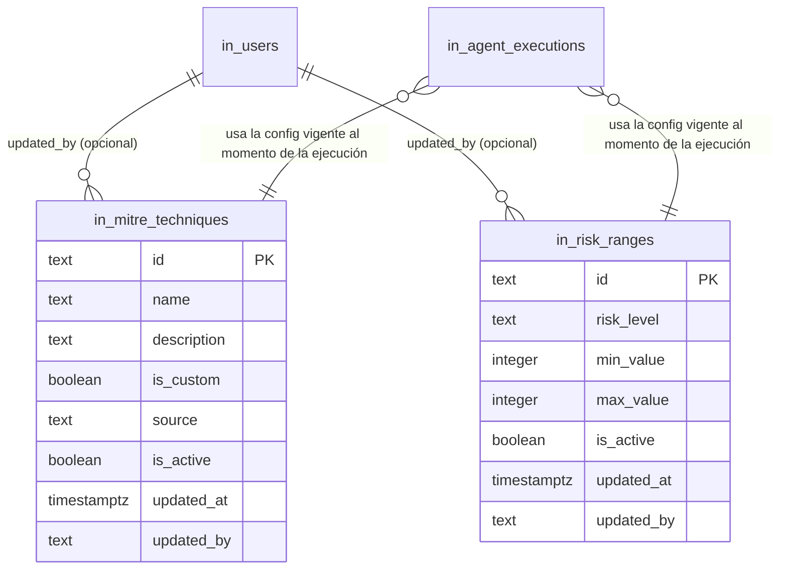

# ALARM_CONFIGURATION_ARCHITECTURE.md — Configuración persistente para enriquecimiento de alarmas

> Documento de diseño — **no se implementa código en este documento**. Basado en inspección
> directa del código actual (`backend/app/providers/`, `backend/app/models/domain.py`), del
> Supabase real del proyecto (esquema en vivo, no solo `supabase_schema.sql`), y del archivo
> `data/thomas_tgs_tps_alarmas_julio.xlsx` (hojas `Hoja1`, `Criticidad`, `ID Mitre`, `Alarmas`).
>
> Nota sobre el prefijo: el mensaje original decía "usar prefijo y" — asumo que se refiere al
> prefijo `in_` que ya usa todo el proyecto (confirmado contra el Supabase real: `in_companies`,
> `in_users`, `in_data_sources`, `in_data_imports`, `in_report_templates`, `in_agent_executions`,
> `in_conversations`, `in_messages`, `in_reports`, `in_report_versions` — ninguna otra tabla del
> proyecto usa otro prefijo). Si querías decir algo distinto, decímelo antes de aprobar.

## 1. Arquitectura actual

### 1.1 Dónde se calcula `Riesgo` hoy

`risk_level_from_score()` en [backend/app/models/domain.py:25](backend/app/models/domain.py#L25) —
una función pura, **con los umbrales hardcodeados en el código**:

```python
def risk_level_from_score(score: int | None) -> RiskLevel:
    if score is None: return RiskLevel.ANULADO
    if score > 90: return RiskLevel.CRITICO
    if score > 70: return RiskLevel.ALTO
    if score > 50: return RiskLevel.MEDIO
    return RiskLevel.BAJO
```

Dos llamadores, ambos síncronos, ambos en el constructor del `DataProvider` (una sola vez por
proceso, cacheado con `@lru_cache` en `app/providers/factory.py:get_data_provider()`):

- `ExcelDataProvider` ([excel_ingestion.py:219](backend/app/providers/excel_ingestion.py#L219)) —
  calcula `computed_risk` con esta función, pero si la columna `Riesgo` de la fila viene con un
  valor válido (`Critico`/`Alto`/`Medio`/`Bajo`), **usa ese valor de la fuente en vez del
  calculado**, y solo registra un warning si difieren.
- `MockDataProvider` ([mock.py:43](backend/app/providers/mock.py#L43)) — la usa directo, sin
  override posible (el dataset mock no trae una columna `Riesgo` propia).

### 1.2 Dónde se calcula `descripcion_mitre` hoy

`load_mitre_catalog()` ([excel_ingestion.py:35](backend/app/providers/excel_ingestion.py#L35))
lee un **JSON estático** (`data/mitre_tactics.json`, 15 entradas: las 14 tácticas oficiales +
`CUST01`/"Disconnection") una sola vez, al construir `ExcelDataProvider`. La resolución ocurre en
[excel_ingestion.py:234-242](backend/app/providers/excel_ingestion.py#L234):

```python
if mitre_id and mitre_id.upper() != "ANULADO":
    tactic = mitre_catalog.get(mitre_id)
    if tactic:
        mitre_name = tactic.name_es
    else:
        mitre_name = _clean_text(row.get("descripcion mitre"))   # <- usa el texto libre de la fila
        warnings.append(f"... mitre id '{mitre_id}' not in catalog, using source label")
```

Es decir: **hoy, si el ID MITRE no está en el catálogo, el sistema SÍ usa lo que sea que venga en
la columna de texto libre del Excel** — justo lo que el requerimiento actual prohíbe ("no
inventar una descripción"). Es un comportamiento a corregir, no solo a migrar.

`MockDataProvider` nunca setea `mitre_tactic_id`/`mitre_tactic_name` (siempre `None`) — no pasa
por este camino.

### 1.3 Cómo se usa el Excel hoy

`ExcelDataProvider.__init__` ([excel.py:33](backend/app/providers/excel.py#L33)) lee y parsea
**todo el archivo completo en memoria**, una sola vez por proceso (vía `@lru_cache` en la
factory). Todo lo que está aguas abajo (tools, agente LangGraph, pipeline determinístico,
generador de informes) lee exclusivamente de esa lista en memoria de `NormalizedSecurityAlert` —
nunca vuelve a tocar el Excel ni Supabase para los datos de alarma en sí.

Lo único que **sí** se persiste en Supabase hoy relacionado al Excel es **metadata de
importación** — no las alarmas ni las reglas de enriquecimiento — vía
`ingestion_service.record_excel_import()`
([ingestion_service.py](backend/app/services/ingestion_service.py)), llamado una vez desde
`lifespan()` en `main.py`, después de que el provider ya está construido:

- `in_companies` — una fila por cliente distinto encontrado en la hoja.
- `in_data_sources` — una fila por (empresa, `source_type="excel"`).
- `in_data_imports` — una fila por import, con `file_hash`, `row_count`, `warnings` (jsonb).

**Importante:** `in_security_alerts` — la tabla que [DATA_MODEL.md §2](DATA_MODEL.md) (Fase 2)
decidió crear para persistir las alarmas normalizadas — **nunca se implementó**. Existe en
`supabase_schema.sql` (diseño) pero no en el Supabase real del proyecto (verificado con
`list_tables` contra la instancia en vivo). Las alarmas siguen viviendo solo en memoria,
reconstruidas del Excel en cada arranque del proceso.

### 1.4 Esquema Supabase actual (verificado en vivo, no solo en el SQL de diseño)

| Tabla | Filas hoy | Rol |
|---|---|---|
| `in_conversations`, `in_messages` | 2, 2 | Historial de chat |
| `in_reports`, `in_report_versions` | 2, 2 | Informes generados |
| `in_companies` | 1 | Identidad de empresa (poblada por `ingestion_service`) |
| `in_users` | 1 | Fila única `master` (no Supabase Auth) |
| `in_data_sources` | 1 | Una fuente de datos por empresa |
| `in_data_imports` | 1 | Auditoría de cada import (hash, warnings, row_count) |
| `in_report_templates` | 1 | Metadata de templates de informe (`csoc_mensual`) |
| `in_agent_executions` | 21 | Auditoría de cada ejecución del pipeline (Fase 4/8/9) |

Convención observada y usada por el diseño propuesto: PK `text` generada en la app
(`db.new_id(prefix)` → `"prefix-<12 hex>"`), `created_at timestamptz default now()`, `is_active
boolean default true` donde aplica (`in_data_sources`, `in_report_templates`), acceso vía
`app/services/supabase_rest.py` (wrapper mínimo sobre PostgREST, filtros `eq.` solamente hoy) y
repositorios en `app/services/repositories.py` (una clase liviana por tabla, sin ORM).
**Ninguna tabla existente tiene `updated_at`/`updated_by` ni versionamiento** — ver §4.4 sobre por
qué esta propuesta sí los agrega para las dos tablas nuevas.

## 2. Problema identificado

### 2.1 Las reglas de enriquecimiento están hardcodeadas en Python

Confirmado en §1.1/§1.2 — exactamente el problema que este documento resuelve. Ningún test ni
código depende de que estén hardcodeadas por una razón técnica real; es simplemente cómo se
implementó el POC original.

### 2.2 Hallazgo con evidencia real: hay DOS tablas de rangos de riesgo en el Excel, y difieren entre sí — y ninguna es exactamente lo que el código hardcodea

El workbook tiene **tres** hojas relevantes, no una ("Hoja 1" en el pedido original en realidad
son dos hojas distintas: `Hoja1` y `Criticidad`):

| Fuente | BAJO | MEDIO | ALTO | CRITICO |
|---|---|---|---|---|
| Hoja `Hoja1` (coincide exactamente con lo que pediste en este mensaje) | 1–50 | 51–70 | 71–95 | 96–100 |
| Hoja `Criticidad` (la que el código actual dice haber usado como referencia) | 1–49 | 50–69 | 70–89 | 90–100 |
| Código actual (`risk_level_from_score`, umbral estricto `>`) | 1–50 | 51–70 | 71–90 | 91–100 |

Verifiqué las tres contra los datos reales de la hoja `Alarmas` (169 filas, columna `Riesgo` ya
etiquetada por el cliente) mirando específicamente los valores límite (49, 50, 51, 69, 70, 71, 89,
90):

```
boundary rows reales: (49,Bajo) (50,Bajo) (51,Medio) (69,Medio) (70,Medio) (71,Alto) (89,Alto) (90,Alto)
```

**Los rangos de `Hoja1` son 100% consistentes con estos datos reales.** Los de `Criticidad` NO
lo son (p. ej. `Criticidad` dice que 50 es "Medio", pero la fila real con severity=50 está
etiquetada "Bajo" por el cliente). El código actual también es consistente con los datos
*observados*, pero solo por casualidad: nunca hay una alarma real con severity 91–95 en el
dataset, así que la única zona donde el código actual (91–100 = Critico) y `Hoja1` (96–100 =
Critico) difieren nunca fue puesta a prueba.

**Conclusión: `Hoja1` es la tabla de configuración correcta y vigente** (coincide exactamente con
los datos reales donde hay evidencia, y con lo que especificaste en este mensaje).
`Criticidad` parece una versión anterior/obsoleta dejada en el archivo. El test existente
`test_risk_level_matches_source_riesgo_column_for_every_row`
([test_excel_ingestion.py:38](backend/tests/test_excel_ingestion.py#L38)) sigue pasando con los
rangos de `Hoja1` (verificado) — no hay conflicto con el POC actual, solo una corrección de un
límite (91–95) que hasta ahora era imposible de detectar por falta de datos.

**Esto no es un cambio de semántica no autorizado** — es adoptar literalmente la tabla que
pediste, con evidencia de que es la correcta. Lo dejo documentado igual porque cambia
silenciosamente el resultado de clasificación para alarmas futuras con severity 91–95 (antes
"Critico", con `Hoja1` serían "Alto"), y quiero que quede explícito antes de aprobar.

### 2.3 El "no encontrado" de MITRE hoy usa un valor inventado, no un estado controlado

Como se ve en §1.2, si el ID MITRE de una fila no está en el catálogo, hoy el sistema usa el
texto libre de la columna `descripcion mitre` de esa misma fila — que es exactamente lo que el
nuevo requerimiento prohíbe. Esto se corrige en el diseño propuesto (§3.4).

### 2.4 El diseño de Fase 2 para persistir alarmas nunca se ejecutó

`in_security_alerts` fue diseñada pero no aplicada (§1.3). Esto es relevante para este documento
porque decide **dónde vive el resultado del enriquecimiento**: hoy el enriquecimiento ocurre
dentro del parseo del Excel, en memoria, sin persistencia por fila. La propuesta de este documento
no depende de resolver esa brecha (no es su alcance), pero sí dejar el motor de enriquecimiento
diseñado de forma que funcione igual el día que `in_security_alerts` (o su equivalente para una
fuente API) exista.

## 3. Arquitectura propuesta

### 3.1 Principio: separar el motor de enriquecimiento de la fuente de datos

Hoy `risk_level_from_score()` y la resolución MITRE viven *dentro* de `excel_ingestion.py` (el
parser del Excel) y de `mock.py`. Se extraen a un módulo nuevo, independiente de cualquier
`DataProvider` concreto:

```
app/services/alarm_enrichment/
    config.py       -- carga la config activa desde Supabase (MITRE + rangos de riesgo)
    engine.py        -- funciones puras: enrich_risk(score, config) / enrich_mitre(id, config)
```

`excel_ingestion.py`, `mock.py`, y (a futuro) el ingestor de la API JSON llaman a este módulo en
vez de tener su propia lógica — **exactamente el mismo patrón que ya existe** para
`DataProvider` (una abstracción, múltiples fuentes). El motor no sabe si el dato vino de Excel,
JSON o cualquier otra fuente — cumple el requerimiento de la sección 6/7 del pedido original.

### 3.2 Carga de configuración: snapshot por ejecución de ingesta, no caché de por vida del proceso

Hoy `ExcelDataProvider` se construye una vez por proceso (`@lru_cache`) y con él, el catálogo
MITRE (JSON estático, leído una vez). Si la config de enriquecimiento pasa a vivir en Supabase,
cachearla también "de por vida del proceso" violaría el requisito explícito: *"si un
administrador modifica los rangos... el procesamiento de nuevas alarmas debe usar
automáticamente la nueva configuración"*.

Propuesta: `alarm_enrichment/config.py` expone una función async
`load_active_config() -> AlarmEnrichmentConfig` (un objeto en memoria simple: dict de técnicas
MITRE activas + lista de rangos de riesgo activos, ordenados) que se llama **una vez por cada
ejecución de ingesta** (cada vez que se importa/reprocesa un lote de alarmas), no una vez por vida
del proceso. Como la ingesta hoy ya ocurre en un punto async (`lifespan()` → `record_excel_import`
es `async def`), esto no requiere volver async nada que hoy sea sync en el *request path* — solo
el momento de construcción del provider al arrancar, que ya tolera I/O (ya hace requests HTTP a
Supabase en el mismo lifespan). El resultado (`AlarmEnrichmentConfig`) se pasa luego, ya
resuelto, a las funciones puras de `engine.py` — que siguen siendo síncronas, testeables sin red,
igual que `risk_level_from_score` hoy.

Esto dejar el diseño listo para el caso real de producción: cuando la fuente sea una API que
ingesta continuamente (no un proceso que arranca una vez), cada ingesta seguirá pidiendo la
config vigente, nunca una copia fosilizada del arranque.

### 3.3 Enriquecimiento de `Riesgo`

`engine.enrich_risk(score: int | None, ranges: list[RiskRange]) -> RiskLevel`:

1. `score is None` → `RiskLevel.ANULADO` (sin cambios — esto ya es un caso separado, no depende
   de rangos numéricos).
2. Buscar el primer rango activo donde `range.min_value <= score <= range.max_value`.
3. Si se encuentra, devolver ese `risk_level`.
4. **Si no se encuentra ningún rango que cubra el valor** (gap en la configuración, o config
   vacía/inactiva) — no asumir ni inventar un nivel. Ver §5 (validación) para por qué esto no
   debería poder pasar en la práctica, y §3.4 para el comportamiento controlado si pasa igual.

### 3.4 Enriquecimiento de `descripcion_mitre`

`engine.enrich_mitre(mitre_id: str | None, catalog: dict[str, MitreTechnique]) -> MitreEnrichmentResult`:

```python
class MitreEnrichmentResult(BaseModel):
    mitre_id: str | None
    descripcion_mitre: str | None   # None si no se encontró -- nunca un valor inventado
    found: bool
```

- ID presente en catálogo y activo → `descripcion_mitre` = el nombre configurado, `found=True`.
- ID ausente, o presente pero **inactivo** → `descripcion_mitre=None`, `found=False`. Nunca cae
  al texto libre de la fuente (corrige §2.3).
- El caso `found=False` se registra como advertencia de ingesta (mismo canal que ya existe:
  `warnings` en `in_data_imports`, sin tabla nueva) **y** queda identificable para
  administración: la lista de `mitre_id` distintos vistos con `found=False` en la corrida actual
  se expone en un endpoint de solo lectura (§6.4) para que el operador vea "estos códigos
  aparecieron en los datos pero no están en el catálogo" sin tener que leer logs.
- En el informe/reporte: una sección que muestra desglose por MITRE
  (`get_mitre_analysis` en `security_tools.py`) debe mostrar el `mitre_id` crudo con una etiqueta
  explícita tipo "Descripción no disponible" en vez de omitir la fila o inventar texto —
  comportamiento controlado, no silencioso.

### 3.5 Forma en que el agente/reporte reciben el dato (sin cambios de contrato)

`NormalizedSecurityAlert.risk_level` y `.mitre_tactic_name` **mantienen exactamente la misma
forma que hoy** — el cambio es solo de dónde viene el valor con el que se llenan, no la forma.
Confirmé que todo el consumo aguas abajo (`security_tools.py`, `templates.py`, `narrative.py`)
solo lee estos dos campos ya resueltos en el modelo — **cero cambios necesarios en el agente
LangGraph, las tools, o el generador de informes**. Esto ya satisface literalmente el requisito de
la sección 8 del pedido ("el agente recibe información ya normalizada/enriquecida").

## 4. Modelo de datos

### 4.1 `in_mitre_techniques`

```sql
create table in_mitre_techniques (
    id            text primary key,              -- p.ej. "TA0001", "CUST01" -- el propio código MITRE (o custom), no un id generado
    name          text not null,                  -- p.ej. "Acceso inicial"
    description   text,                           -- opcional, texto largo
    is_custom     boolean not null default false, -- true para códigos propios del cliente (CUST01)
    source        text,                           -- p.ej. "excel:ID Mitre" en la carga inicial, o "manual" si lo creó un operador
    is_active     boolean not null default true,
    created_at    timestamptz not null default now(),
    updated_at    timestamptz not null default now(),
    updated_by    text                            -- username del operador (in_users.username), null si fue la carga inicial
);
```

`id` es el propio código MITRE — no un id generado — porque ya es un identificador natural,
estable y es exactamente la clave por la que se busca (`mitre_catalog.get(mitre_id)` hoy). Evita
un join innecesario para lo que hoy es un `dict[str, ...]` en memoria.

### 4.2 `in_risk_ranges`

```sql
create table in_risk_ranges (
    id            text primary key default ('risk-' || substr(gen_random_uuid()::text, 1, 12)),
    risk_level    text not null check (risk_level in ('Critico','Alto','Medio','Bajo')),
    min_value     integer not null check (min_value >= 1 and min_value <= 100),
    max_value     integer not null check (max_value >= 1 and max_value <= 100),
    is_active     boolean not null default true,
    created_at    timestamptz not null default now(),
    updated_at    timestamptz not null default now(),
    updated_by    text,
    check (min_value <= max_value)
);
```

`risk_level` reusa los mismos cuatro valores de texto que ya existen en `RiskLevel`
(`app/models/domain.py`) — **no** se reutiliza `Anulado` acá: la anulación depende de si la
severidad es `None`/"ANULADO", nunca de un rango numérico, así que sigue siendo un caso de código
aparte (§3.3 punto 1), no una fila de esta tabla.

**No superposición y no gaps entre rangos activos** — no se modela con una constraint SQL
exótica (una `EXCLUDE USING gist` con `btree_gist` serviría, pero agregaría una extensión de
Postgres nueva solo para esto). Se valida en la capa de aplicación (§5), siguiendo el mismo
estilo que ya usa el proyecto (`get_template()` levanta `ValueError` con mensaje claro,
`validate_request()` en `pipeline.py` devuelve una lista de errores) — consistente con "evitar
tecnología nueva sin justificar".

### 4.3 Por qué NO se crea una tabla de 100 filas (valor → riesgo)

Confirmado con el código actual: `risk_level_from_score` ya opera sobre rangos, nunca sobre 100
valores individuales — no hay ningún consumidor que necesite "el riesgo del valor 47" como fila
independiente. `in_risk_ranges` con `min_value`/`max_value` es estrictamente equivalente y es la
opción que el propio pedido recomienda. Esto no cambia la semántica del POC: es la misma
operación (`score → nivel`) con la tabla de reglas movida de código a datos.

### 4.4 Versionamiento, auditoría, `created_by`/`updated_by`

Ninguna tabla existente del proyecto tiene estos campos (§1.4) — agregarlos acá es una desviación
del patrón actual, así que la justifico explícitamente en vez de asumirla:

- **`updated_at` + `updated_by` sí, en ambas tablas nuevas.** Es la única forma barata de
  responder "¿quién cambió esto y cuándo?" para una regla que, como decís, afecta directamente
  los informes. `updated_by` es el `username` del operador autenticado (mismo actor que ya
  identifica `triggered_by` en `in_agent_executions` — no hace falta una tabla de usuarios nueva,
  ya existe `in_users`).
- **Versionamiento completo (historial de cada cambio) — NO se propone crear una tabla nueva
  todavía.** Sería `in_config_audit_log` (antes/después, quién, cuándo) — mismo patrón que Fase 9
  dejó pendiente para un audit log genérico de acciones CRUD (`SECURITY_REVIEW.md` §"Audit Logs
  (genérico)"). Sigue esa misma decisión: no construir un mecanismo genérico sin un caso de uso
  concreto todavía. Lo que si se propone (mínimo, ya suficiente para trazabilidad de informes):
  **snapshot de la config usada, no historial completo de cambios** — ver siguiente punto.
- **Trazabilidad de qué config generó qué informe: extender, no crear.**
  `in_agent_executions` ya guarda `system_version` (commit de git) por ejecución
  (`QUALITY_OBSERVABILITY.md`/`SECURITY_REVIEW.md`). Se propone agregar una columna
  `enrichment_config_version` (texto simple, p.ej. hash corto de
  `(max(in_risk_ranges.updated_at), max(in_mitre_techniques.updated_at))`, o el `updated_at` más
  reciente entre ambas tablas) — barato, no requiere una tabla de versiones, y responde "¿esta
  ejecución usó la config vieja o la nueva?" sin guardar el historial completo. Si en el futuro se
  necesita reconstruir el valor exacto de un rango tal como estaba en el pasado, ese es el
  momento de justificar `in_config_audit_log` — no antes.

### 4.5 Diagrama ER (incremental sobre el esquema existente)



Sin FK física desde `in_agent_executions` a las tablas de config (la relación es "usó la config
vigente en ese momento", no una fila específica) — se registra como el campo
`enrichment_config_version` descrito arriba, no como una foreign key.

## 5. Flujo de procesamiento

```
Alarma cruda (Excel row | futuro: JSON de API)
    │
    ▼
Normalización a NormalizedSecurityAlert (sin Riesgo/descripcion_mitre resueltos aún)
    │
    ▼
alarm_enrichment.load_active_config()  ──►  Supabase: in_risk_ranges (is_active=true),
    │                                                  in_mitre_techniques (is_active=true)
    ▼
engine.enrich_risk(severity_score, config.risk_ranges)      → RiskLevel
engine.enrich_mitre(mitre_id, config.mitre_techniques)       → descripcion_mitre | None + found
    │
    ▼
NormalizedSecurityAlert completo (Riesgo + descripcion_mitre ya resueltos)
    │
    ▼
DataProvider (excel | mock | api) lo expone tal como hoy
    │
    ▼
Tools / Agente LangGraph / Pipeline determinístico / Informe  (sin cambios, §3.5)
```

## 6. Flujo Excel → configuración

Este flujo **no vuelve a ejecutarse en cada arranque** salvo la primera vez (siembra inicial) —
una vez que la config vive en Supabase, el Excel deja de ser la fuente de las reglas (aunque siga
siendo la fuente de las alarmas mismas, eso no cambia con este documento).

1. **Siembra única** (script de migración de datos, no parte del request path): leer `Hoja1` del
   Excel (confirmado como la tabla vigente, §2.2) e `ID Mitre`, y hacer `insert` en
   `in_risk_ranges` / `in_mitre_techniques` con `source="excel:Hoja1"` /
   `source="excel:ID Mitre"`. Se ejecuta una vez, manualmente o como script único — no queda
   como parte de `ingestion_service.record_excel_import()` (que corre en cada arranque del
   backend); repetirlo en cada arranque duplicaría filas o pisaría cambios hechos desde la UI
   administrativa, que es justamente lo que no debe pasar.
2. **Después de la siembra**, `record_excel_import()` (que sigue corriendo en cada arranque, sin
   cambios) sigue registrando metadata de import (`in_data_imports`) como hoy — pero el
   enriquecimiento de cada fila ya no calcula reglas propias, llama a
   `alarm_enrichment.load_active_config()` (§3.2).
3. La hoja `Criticidad` (obsoleta, §2.2) no se migra — queda documentada acá como la razón por la
   que se descartó, para que no se reintroduzca por error en el futuro.

## 7. Flujo API → configuración

Sin cambios respecto al diseño ya existente de `ApiDataProvider` (`app/providers/api.py`,
placeholder documentado en `INGESTION_ARCHITECTURE.md` §6) — este documento no introduce nada
nuevo acá, solo confirma que encaja:

```
API JSON → ApiDataProvider (futuro) → normaliza a NormalizedSecurityAlert (sin Riesgo/MITRE aún)
    → alarm_enrichment.load_active_config() + engine.enrich_* (mismo motor, sin cambios)
    → NormalizedSecurityAlert completo → resto del pipeline, sin cambios
```

El motor de enriquecimiento (`alarm_enrichment/`) es exactamente el mismo módulo para ambas
fuentes — es la pieza que hace cierta la afirmación del pedido original: *"la lógica de
enriquecimiento debe ser independiente de si la alarma proviene de Excel, API JSON u otra futura
fuente"*.

## 8. Administración desde la aplicación (UI)

Sin librería de routing en el frontend hoy (confirmado: no hay `react-router` en
`package.json`; `App.tsx` alterna entre "Chat"/"Formulario" con un simple `useState<View>`).
Se propone agregar una tercera pestaña **"Configuración"** siguiendo exactamente ese mismo
patrón — sin agregar una librería nueva ni un concepto de rol/permiso nuevo (no existe un rol
"admin" separado hoy, §"single hardcoded operator login"; la pestaña queda detrás del mismo
`require_auth` que ya protege todo).

### 8.1 Sección MITRE

- Tabla con todas las técnicas (`GET /api/config/mitre-techniques`, incluye inactivas con un
  filtro).
- Buscar por ID (`?id=TA00...`) y por nombre (`?q=acceso`, usa `ilike` — requiere extender
  `supabase_rest.py::select()` con un parámetro de búsqueda por patrón, hoy solo soporta `eq.`;
  cambio pequeño y aislado).
- Crear (`POST`), editar (`PATCH /{id}`), activar/desactivar (`PATCH /{id}` con `is_active`).
- El `id` (código MITRE) no se edita una vez creado — crear una fila nueva si el código cambia,
  igual que cualquier catálogo con clave natural.

### 8.2 Sección Rangos de riesgo

- Tabla con los 4 rangos activos, mostrando claramente qué valores (1–100) caen en cada nivel —
  una previsualización visual simple (barra 1–100 coloreada por tramo) ayuda a detectar gaps de
  un vistazo, aunque la validación real la hace el backend (§9).
- Crear/editar/activar/desactivar, con la validación de la sección 9 corriendo en el submit y
  devolviendo un error claro y específico (qué se superpone con qué, o dónde queda el gap) — no
  un 500 genérico.

## 9. Validaciones

Todas del lado del backend (la UI solo las refleja, nunca es la única barrera):

| Regla | Dónde |
|---|---|
| `min_value <= max_value` | constraint SQL (defensa en profundidad) + validación en el service antes del insert/update, con mensaje claro |
| `min_value`/`max_value` dentro de 1–100 | constraint SQL + service |
| Sin superposición entre rangos **activos** | Solo en el service (no hay constraint SQL simple para esto sin `btree_gist`, ver §4.2) — se recalcula contra todos los rangos activos existentes en cada create/update |
| Sin gaps entre rangos activos que cubran menos de 1–100 completo | Se valida como advertencia bloqueante: sin los 4 niveles activos cubriendo el rango completo, el enriquecimiento podría dejar alarmas sin nivel (§3.3 punto 4) — el sistema debe rechazar guardar una configuración que deje huecos, no aceptarla y fallar después silenciosamente |
| Duplicados de código MITRE | `id` es PK — el insert falla naturalmente; el service traduce el error de Postgres a un mensaje claro en vez de propagar el 409/500 crudo |
| Campos obligatorios | Pydantic en el schema de request (mismo patrón que el resto de la API) |
| Config activa disponible para procesar alarmas | Si `load_active_config()` devuelve cero rangos activos o cero técnicas MITRE activas, la ingesta debe fallar con un error explícito (mismo canal que ya usa `pipeline.validate_request` — lista de errores, no una excepción no capturada) — nunca "seguir igual" con una config vacía |

Filosofía: **"informar claramente el problema y no generar silenciosamente resultados
incorrectos"** (tal como pedís) se traduce, en el estilo ya existente del proyecto, a devolver
listas de errores explícitas desde el service (como ya hace `validate_request()` en
`pipeline.py` y `get_template()` en `templates.py`), nunca un valor por defecto inventado.

## 10. Integración con LangGraph

**Sin cambios en el agente.** Ya lo confirma §3.5: el agente, las tools (`security_tools.py`), y
el generador de informes (`templates.py`, `narrative.py`) consumen `NormalizedSecurityAlert.
risk_level` y `.mitre_tactic_name` como campos ya resueltos — nunca calculan nada. Moverlos de
"calculados con función hardcodeada" a "calculados con config de Supabase" no cambia el contrato
que el agente ve; el ejemplo del pedido original ya es literalmente la forma actual del dato:

```json
{
  "mitre_id": "TA0001",
  "descripcion_mitre": "Acceso inicial",
  "risk_score": 82,
  "riesgo": "ALTO"
}
```

Único ajuste necesario aguas abajo: donde hoy `mitre_tactic_name` nunca es `None` en la práctica
(porque el fallback silencioso de §2.3 siempre rellenaba algo), pasará a poder ser `None`
legítimamente (`found=False`, §3.4). Hay que revisar los puntos que ya manejan "sin dato" con el
mismo patrón que usan hoy para otros campos opcionales (p.ej. `category` ya usa `"Sin categoría"`
como fallback visible) — se decide en la fase de implementación, no en este documento.

## 11. Estrategia de pruebas

Sigue el patrón ya existente en `tests/test_excel_ingestion.py` (fixtures pequeñas, sin mocks de
red para la lógica pura; Supabase real solo se toca en los tests que ya lo hacen hoy vía
`fake_supabase`/`FakeSupabase` de `conftest.py`).

### 11.1 Riesgo (`engine.enrich_risk`)

Contra una config sintética equivalente a `Hoja1` (1–50/51–70/71–95/96–100):

```
1 → BAJO      50 → BAJO
51 → MEDIO    70 → MEDIO
71 → ALTO     95 → ALTO
96 → CRITICO  100 → CRITICO
```

Más: `score=None` → `ANULADO`; `score=0` y `score=101` (fuera de 1-100, valores inválidos);
config con rangos modificados (otro set de límites, confirmando que el resultado sigue la config
y no un valor hardcodeado); config con rangos superpuestos (debe rechazarse al guardar, §9 — un
test de integración contra el endpoint, no de `enrich_risk` en sí, que asume una config ya
válida); config incompleta (menos de 4 rangos activos, o con un gap) → error explícito, no un
`None` silencioso ni una excepción no controlada.

### 11.2 MITRE (`engine.enrich_mitre`)

```
TA0001 → "Acceso inicial"
TA0040 → "Impacto"
CUST01 → "Disconnection"
```

Más: MITRE inexistente en catálogo → `descripcion_mitre=None`, `found=False`; MITRE existente
pero `is_active=false` → mismo resultado que inexistente (una técnica desactivada no debe
resolverse, aunque el registro siga en la tabla); `mitre_id=None`/vacío → passthrough, no es un
"no encontrado" (es la ausencia legítima de MITRE en la alarma, ya contemplada hoy con
`mitre_id.upper() == "ANULADO"`); duplicados — no aplica a nivel de `enrich_mitre` (la PK de la
tabla ya lo impide), se prueba a nivel de endpoint de creación (§9).

### 11.3 Regresión obligatoria

`test_risk_level_matches_source_riesgo_column_for_every_row` (existente) debe seguir pasando
contra los 169 registros reales del Excel, con la config sembrada desde `Hoja1` — es la prueba de
que adoptar `Hoja1` (§2.2) no cambia el comportamiento observable actual del POC.

---

## Resumen de decisiones para tu revisión

1. **Prefijo `in_`** para las tablas nuevas, confirmado contra el proyecto real (confirmá si
   "usar prefijo y..." quería decir otra cosa).
2. **Adoptar los rangos de `Hoja1`** (1–50/51–70/71–95/96–100) como los correctos, con evidencia
   de que son consistentes con los datos reales y de que `Criticidad` (la otra hoja) no lo es —
   esto corrige un límite (91–95) que el código actual clasifica distinto, aunque invisible hoy
   por falta de datos de prueba en ese rango.
3. **2 tablas nuevas**: `in_mitre_techniques`, `in_risk_ranges`, ambas con
   `updated_at`/`updated_by` pero **sin** tabla de historial/audit log todavía (se propone un
   campo liviano `enrichment_config_version` en `in_agent_executions` en su lugar — trazabilidad
   barata, no historial completo).
4. Un módulo nuevo `app/services/alarm_enrichment/` (config + engine) del que dependen
   `excel_ingestion.py`, `mock.py`, y el futuro ingestor de API — cero cambios en agente/tools/
   generador de informes.
5. Nueva pestaña "Configuración" en el frontend, mismo patrón que las dos pestañas existentes,
   sin librería nueva ni rol de permisos nuevo.
6. Validaciones (solapamiento, gaps, duplicados, campos obligatorios) en el backend, mismo estilo
   ya usado por `validate_request()`/`get_template()` — sin extensión de Postgres nueva.

**Quedo a la espera de tu aprobación antes de implementar.** Si algo de lo anterior no es lo que
tenías en mente (en particular el punto 2, que es una corrección de comportamiento, no solo una
migración de dónde vive la regla), decímelo y lo ajusto antes de tocar código.
