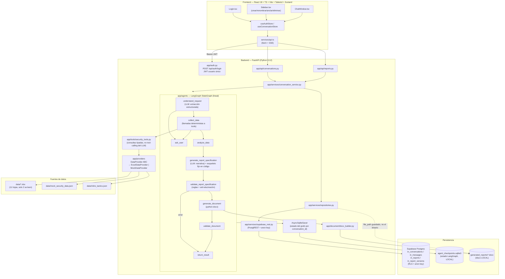

# ARCHITECTURE_ASSESSMENT.md — Fase 0: Auditoría de la arquitectura actual

> Generado a partir de una revisión completa del código fuente (backend, frontend, datos,
> infraestructura) en `/Users/ivanclabe/Workspace/ai-security-report-generator`, sin modificar
> ningún archivo. Fecha de la auditoría: 2026-09-14.

## 1. Resumen ejecutivo

El POC es una aplicación de dos capas (React + FastAPI) que envuelve un **único agente LangGraph
lineal** para producir un informe mensual de gestión CSOC en formato **.docx**, a partir de un
**Excel real de un cliente** (169 alarmas). Funciona de punta a punta hoy: un analista escribe una
solicitud en un chat, el sistema identifica empresa/período, consulta los datos, arma una
especificación de informe con una estructura fija de 11 secciones (calcada del documento real que
el cliente comparte cada mes) y genera un `.docx` con la marca del proveedor SOC.

El POC está más maduro de lo que su tamaño sugiere en dos aspectos concretos: (1) el agente **no
alucina por diseño** — la narrativa del LLM se valida contra los `alarm_number` realmente
recolectados antes de aceptar el informe — y (2) la capa de datos ya está detrás de una
abstracción `DataProvider` limpia, pensada explícitamente para admitir una fuente API/JSON futura
sin tocar el agente ni las herramientas.

Sin embargo, frente a los objetivos del prompt maestro, existen **brechas estructurales
importantes**, no de calidad sino de alcance:

- **No existe modalidad determinística.** El 100% de las solicitudes pasan por extracción de
  campos vía LLM sobre texto libre (`understand_request`). No hay formulario, API paramétrica ni
  ruta que evite el LLM para una solicitud reproducible.
- **El "agente" no usa tool-calling.** Las funciones en `security_tools.py` son invocadas de forma
  determinística por el nodo `collect_data`, no elegidas por el modelo. El LLM solo hace dos
  llamadas acotadas: extraer campos estructurados y redactar prosa sobre un JSON ya armado por
  código. Esto es una fortaleza de confiabilidad, pero no es el patrón "agente con herramientas"
  que describen las Fases 4 y 6 del prompt maestro — hay que decidir si evolucionar hacia eso o
  formalizar (y documentar) que el diseño actual es intencional.
- **Persistencia dividida y parcialmente fuera de Supabase.** Conversaciones/mensajes/informes ya
  viven en Supabase (`in_*`, migrado en la sesión anterior), pero el **estado del agente
  (checkpointer de LangGraph)** y los **archivos .docx generados** siguen en disco local del
  contenedor backend — im compatible con múltiples réplicas o redeploys.
- **Una sola plantilla, un solo formato, una sola marca.** No hay sistema de plantillas por tipo de
  informe, no hay generación de PDF, y el branding (logo, colores) está codificado directamente en
  `docx_builder.py` para un único proveedor SOC.
- **Sin control de versiones.** El proyecto no es un repositorio git (`git status` falla). Esto es
  un riesgo de producción independiente de la calidad del código.
- **Sin observabilidad ni auditoría persistente.** No hay registro de ejecuciones del agente,
  duración, tokens, costos, ni qué versión del sistema generó cada informe.
- **Autenticación de un solo usuario fijo.** No hay usuarios, roles ni control de acceso por
  organización/cliente — cualquier sesión autenticada puede leer o borrar cualquier conversación.

Ninguno de estos puntos es un defecto de implementación — son omisiones esperables en un POC que
todavía no ha pasado por un diseño de arquitectura objetivo. El código existente (proveedores de
datos, esquema del informe, validación de evidencia, separación docx_builder/narrativa) es una base
sólida y reutilizable para la Fase 1.

## 2. Arquitectura actual

**Patrón:** monolito modular de dos servicios (frontend SPA + backend API), sin microservicios,
sin cola de mensajes, sin caché externo. Persistencia dividida entre Supabase (Postgres vía
PostgREST) y SQLite local (dos archivos distintos, para dos cosas distintas).

```
Cliente (SOC): Excel mensual ──► backend/data/*.xlsx (montado en disco)
                                        │
                                        ▼
Browser (React SPA) ──HTTP/SSE──► FastAPI (uvicorn)
   │                                   │
   │                                   ├── app/api/*        (rutas HTTP)
   │                                   ├── app/auth.py      (JWT, usuario único)
   │                                   ├── app/agents/*     (grafo LangGraph)
   │                                   ├── app/providers/*  (DataProvider: excel | mock)
   │                                   ├── app/tools/*      (consultas tipadas sobre el provider)
   │                                   ├── app/document/*   (python-docx + matplotlib)
   │                                   └── app/services/*   (orquestación + persistencia)
   │                                             │
   │                                             ├──► Supabase Postgres (in_conversations,
   │                                             │      in_messages, in_reports,
   │                                             │      in_report_versions) vía PostgREST
   │                                             ├──► SQLite local (agent_checkpoints.sqlite3)
   │                                             │      -- estado del grafo por conversation_id
   │                                             └──► Disco local (generated_reports/*.docx)
   │
   └── descarga autenticada del .docx vía blob (Authorization: Bearer)
```

No existe capa de mensajería/eventos, no existe caché, no existe balanceador ni múltiples
instancias — el diseño asume un único proceso backend de larga duración (`@lru_cache` en el
provider de datos y en el modelo de chat refuerzan esa suposición).

## 3. Diagrama de componentes



## 4. Flujo de datos

1. **Origen:** un Excel (`data/thomas_tgs_tps_alarmas_julio.xlsx`, 2.7 MB, 11 hojas) que el cliente
   provee mensualmente por fuera del sistema (no hay endpoint de carga/upload — el archivo se monta
   en el contenedor vía `Dockerfile`/volumen).
2. **Ingesta (`app/providers/excel_ingestion.py`):** al construirse `ExcelDataProvider` (una sola
   vez por proceso, cacheado con `@lru_cache` en `factory.py`), se leen **solo 2 de las 11 hojas**:
   - `Alarmas` (170 filas) → `ingest_alarmas_sheet()`: parseo fila a fila con limpieza de artefactos
     de Excel (`_x000D_`), severidad numérica o `"ANULADO"`, multivalor en IP/hostname, derivación
     de `risk_level` verificada empíricamente contra las etiquetas reales del cliente
     (`risk_level_from_score`, umbrales `>90/>70/>50` estrictos).
   - `Top 10 Correos rareza` → `ingest_email_rarity_ranking()`: pivote ya calculado por el cliente,
     usado tal cual (no se recalcula desde el log crudo) para no contradecir un número que el
     cliente ya publica.
   - **Las 9 hojas restantes no se leen en absoluto hoy**: `Tablas`, `Correos Rareza 96-100`
     (34 248 filas, log crudo), `96-100 Rareza1`, `Correos Salientes` (28 filas), `Correos 0-100`
     (118 101 filas, log crudo), `EDR Falcon`, `Hoja1`, `Criticidad` (usada solo para verificar
     manualmente los umbrales, no en runtime), `ID Mitre` (el catálogo real se sirve desde el JSON
     estático `data/mitre_tactics.json`, generado a partir de esta hoja pero no leído en vivo).
3. **Normalización:** todo converge en `NormalizedSecurityAlert` (`app/models/domain.py`), el
   contrato canónico que el resto del sistema consume — el mismo shape que produce
   `MockDataProvider`. Ningún componente aguas abajo del provider conoce el formato original.
4. **Sin persistencia intermedia:** no hay tabla de "raw data" ni "eventos normalizados" en
   Supabase — los datos viven solo en memoria del proceso Python mientras dura, reconstruidos desde
   el Excel cada vez que el proceso arranca. No hay registro de "cuándo se importó este Excel" ni
   metadata de importación, ni forma de saber si dos ejecuciones usaron la misma versión del
   archivo fuente.
5. **Consulta (`collect_data` node → `security_tools.py` → `DataProvider`):** el nodo llama, en un
   orden fijo, a `get_company`, `get_security_summary`, `get_security_alerts`, `get_alert_trends`
   (período + últimos 3 meses), `get_mitre_analysis`, `get_response_metrics`,
   `get_email_security_summary`, `get_ip_indicators`, `get_notifications`. Todo esto ocurre **sin
   intervención del LLM** — es una consulta determinista parametrizada por lo que
   `understand_request` extrajo de la conversación.
6. **Análisis (`analyze_data`):** cálculos puramente aritméticos sobre lo ya recolectado (tendencia,
   tasa de resolución, top categorías) — tampoco pasa por el LLM.
7. **Narrativa (`generate_report_specification` → `generate_narrative`):** se arma un JSON resumido
   (`_build_narrative_payload`, ~11-14 KB) y se envía al LLM (`claude-sonnet-5` vía
   `with_structured_output(ReportNarrative)`) para producir **solo prosa corta** en 7 campos fijos
   más las recomendaciones. La estructura de 11 secciones, las tablas, y qué alarmas son
   "significativas" se calculan en código (funciones `_source_events_table`,
   `_disconnected_agents_table`, `_risk_breakdown_table`, etc.), no por el LLM.
8. **Validación anti-alucinación (`validate_report_specification`):** `ReportSpecification` valida
   reglas de negocio (debe haber secciones y recomendaciones) y, crucialmente,
   `validate_evidence()` rechaza cualquier `alarm_number` citado que no esté en los datos
   realmente recolectados — si falla, el grafo va a `return_result` con `status=error` y el informe
   **no se genera**.
9. **Documento (`generate_document` → `docx_builder.build_document`):** consume únicamente el
   `ReportSpecification` ya validado — nunca texto crudo del LLM — y produce un `.docx` en
   `generated_reports/<conversation_id>-<hash>.docx` en disco local.
10. **Persistencia del resultado:** `conversation_service.process_message` guarda el mensaje del
    usuario y del asistente en `in_messages`, y si el estado final es `ready`, crea/actualiza una
    fila en `in_reports` + una nueva versión en `in_report_versions` (Supabase) — pero el campo
    `file_path` apunta a una ruta en el disco del contenedor backend, **el binario del .docx en sí
    no está en Supabase Storage**.
11. **Descarga:** el frontend pide `GET /api/reports/{id}/download` con el JWT, recibe el binario
    como blob y dispara la descarga en el navegador (cambio reciente — antes era un link estático,
    ahora requiere fetch autenticado porque las rutas de reports están protegidas).

## 5. Flujo del agente

**Framework:** LangGraph `StateGraph` (paquete `langgraph>=0.2.62`), grafo **único y lineal**, sin
supervisor, sin subagentes, sin bucle de tool-calling del LLM. 9 nodos, todos funciones `async def`
que reciben y devuelven fragmentos de un único `TypedDict` (`ReportState`,
`backend/app/agents/state.py`).

**Modelo:** `claude-sonnet-5` vía `langchain-anthropic` (`ChatAnthropic`), instanciado una vez
(`@lru_cache` en `llm.py`) sin `temperature` explícito (Sonnet 5 lo rechaza — ya resuelto). El LLM
se invoca exactamente **dos veces** por turno como máximo:
- En `understand_request`, con `.with_structured_output(ReportRequestUpdate)`, para extraer
  campos (empresa, fechas, tipo, categorías, nivel de riesgo, framework) del mensaje del usuario en
  el contexto de lo ya conocido en la conversación.
- En `generate_narrative` (dentro de `generate_report_specification`), con
  `.with_structured_output(ReportNarrative)`, para redactar prosa corta sobre el JSON ya armado.

**No hay tool-calling real del modelo.** Las "herramientas" en `security_tools.py` (consultar
alertas, tendencias, MITRE, métricas de respuesta, indicadores de correo/IP) son funciones Python
tipadas con Pydantic que **el nodo `collect_data` invoca directamente, en un orden fijo**. El LLM
nunca decide "qué herramienta llamar" — eso ya lo decidió el grafo. Esto es deliberado y es una
fortaleza de confiabilidad (comportamiento 100% reproducible dado el mismo estado de entrada), pero
diverge del patrón "agente con herramientas" que las Fases 4 y 6 del prompt maestro dan por
sentado — es una decisión de diseño a ratificar o revisar explícitamente en la Fase 1, no algo que
deba asumirse como "ya resuelto en ese sentido".

**Estado del agente (`ReportState`):** un único `TypedDict` con reductor "el último valor gana"
(`_replace`) para los campos compuestos (`collected_data`, `analysis`, `report_specification`,
`errors`) — no hay separación entre "estado de entrada", "estado de conversación", "estado de
análisis" y "estado del informe" como objetos distintos; todo vive en el mismo diccionario plano.
Esto funciona bien para el caso actual (un informe por conversación, regenerado in-place) pero
puede volverse difícil de razonar si se agregan más tipos de ejecución (comparaciones entre
períodos, múltiples informes por conversación).

**Persistencia del estado:** `AsyncSqliteSaver` de `langgraph-checkpoint-sqlite`, apuntando a
`agent_checkpoints.sqlite3` **local al contenedor backend**, indexado por `conversation_id` como
`thread_id`. Esto es lo que permite que "regenerar con otro enfoque" funcione sin re-preguntar todo
— el grafo retoma el `ReportState` completo de la conversación. Es el único mecanismo de "memoria"
del agente; no hay memoria vectorial, no hay resumen de conversaciones largas, no hay ventana de
contexto explícita más allá de lo que LangGraph guarda.

**Flujo de ejecución de una solicitud (paso a paso):**
1. `conversation_service.process_message` agrega el mensaje del usuario a `in_messages` y llama a
   `graph.astream_events(...)` con `thread_id=conversation_id`.
2. `understand_request`: LLM extrae campos nuevos/cambiados; decide si falta información
   (`missing_info_question`) o si hay que refrescar datos (`data_refresh_required`, cuando cambia
   empresa/fechas/categoría/riesgo/framework respecto al estado previo).
3. Enrutamiento condicional (`_route_after_understanding`): a `ask_user` (END) si falta info, a
   `collect_data` si hay que refrescar datos, o directo a `generate_report_specification` si el
   usuario solo pidió un cambio de tono/formato sobre datos ya recolectados (ej. "hazlo más
   ejecutivo" reutiliza `collected_data` sin volver a consultar — optimización explícita).
4. `collect_data`: si la empresa no se encuentra, corta a `ask_user`. Si no, ejecuta todas las
   consultas deterministas descritas en la sección 4.
5. `analyze_data`: cálculos aritméticos sobre lo recolectado.
6. `generate_report_specification`: arma el payload, llama al LLM para la narrativa, ensambla las
   11 secciones fijas en código.
7. `validate_report_specification`: reglas de negocio + anti-alucinación; si falla, va a
   `return_result` con error (el grafo **nunca reintenta automáticamente** — el error se muestra al
   usuario tal cual).
8. `generate_document` → `validate_document` (verifica que el archivo exista y no esté vacío) →
   `return_result` (arma el mensaje final para el chat).
9. `conversation_service` persiste el mensaje del asistente y, si hay informe, crea/versiona la fila
   en Supabase y arma el payload `report` que el frontend usa para mostrar la tarjeta de descarga.

**Manejo de errores:** cada nodo que puede fallar de forma esperada (empresa no encontrada, campos
faltantes, documento vacío, validación de evidencia) devuelve `status="error"` o
`"awaiting_user_input"` explícitamente — no hay excepciones no capturadas dentro del grafo salvo
las que ya se envuelven en `conversation_service.process_message` (try/except genérico que
convierte cualquier excepción no prevista en un mensaje de error para el usuario). No hay reintentos
automáticos, backoff, ni circuit breaker ante fallos del proveedor LLM (una falla transitoria de la
API de Anthropic se propaga tal cual al usuario como error).

## 6. Tecnologías identificadas

| Capa | Tecnología | Versión | Notas |
|---|---|---|---|
| Backend framework | FastAPI | 0.115.6 | + Uvicorn 0.34.0 (`[standard]`) |
| Lenguaje backend | Python | 3.12 | |
| Validación/schemas | Pydantic | 2.10.4 | + `pydantic-settings` 2.7.1 para `.env` |
| Agente | LangGraph | ≥0.2.62 | `StateGraph`, un solo grafo lineal |
| Checkpointing agente | `langgraph-checkpoint-sqlite` | ≥2.0.1 | `AsyncSqliteSaver`, **local**, no Supabase |
| Integración LLM | `langchain-anthropic` | ≥0.3.3 | + `langchain-core` ≥0.3.28 |
| Proveedor LLM | Anthropic Claude | `claude-sonnet-5` | único modelo, sin fallback ni multi-proveedor |
| Persistencia app | Supabase Postgres | — | vía PostgREST + `httpx` (sin SDK oficial `supabase-py`) |
| Persistencia agente | SQLite | — | archivo local `agent_checkpoints.sqlite3` |
| Autenticación | JWT hecho a mano | `pyjwt` 2.10.1 | usuario único hardcodeado, sin Supabase Auth |
| Documentos | `python-docx` | 1.2.0 | única salida soportada (no hay PDF) |
| Gráficos en documento | `matplotlib` | 3.10.0 | backend `Agg`, barras de riesgo embebidas como PNG |
| Ingesta Excel | `openpyxl` + `pandas` | 3.1.5 / ≥2.2 | |
| HTTP cliente | `httpx` | 0.28.1 | usado para PostgREST y potencialmente para llamadas futuras |
| SSE (streaming al chat) | `sse-starlette` | 2.2.1 | vía `astream_events` de LangGraph |
| Testing backend | `pytest` + `pytest-asyncio` | 8.3.4 / 0.25.1 | 53 tests, sin tests HTTP/API |
| Eval de calidad LLM | TruLens | 2.14.0 (venv separado) | script offline manual, no en CI |
| Frontend framework | React | 18.3.1 | sin React Router — vista única |
| Lenguaje frontend | TypeScript | 5.7.2 | |
| Build/dev server | Vite | 6.0.7 | proxy `/api` → backend |
| Estilos | Tailwind CSS | 3.4.17 | |
| Estado frontend | Zustand | 5.0.2 | 2 stores: auth, conversaciones |
| Streaming cliente | `@microsoft/fetch-event-source` | 2.0.1 | permite headers custom (Authorization) en SSE, a diferencia de `EventSource` nativo |
| Testing frontend | Vitest + Testing Library | 2.1.8 / 16.1.0 | 2 archivos, 4 tests |
| Infraestructura | Docker Compose | — | 2 servicios (backend, frontend en modo dev) |
| Control de versiones | **ninguno** | — | no es un repositorio git |
| CI/CD | **ninguno** | — | sin `.github/workflows` ni equivalente |

## 7. Fortalezas

- **Anti-alucinación real, no cosmética.** `ReportSpecification.validate_evidence()` rechaza
  informes con citas de alarmas inexistentes; el grafo corta la generación en ese caso. Esto es
  exactamente lo que la Fase 4 del prompt maestro pide y ya existe.
- **Separación estructura/narrativa.** El esqueleto de 11 secciones se arma en código; el LLM solo
  redacta prosa acotada sobre datos ya validados. Esto hace el sistema predecible y barato de
  auditar (se puede diffear la estructura del informe sin tocar el modelo).
- **Abstracción `DataProvider` ya lista para APIs futuras.** `ExcelDataProvider` y
  `MockDataProvider` implementan la misma interfaz y devuelven el mismo
  `NormalizedSecurityAlert`; un `ApiDataProvider` futuro no requeriría tocar `tools/` ni el agente,
  solo `providers/factory.py`. Este es exactamente el contrato de extensibilidad que la Fase 3
  pide — ya existe en germen.
- **Ingesta de Excel con manejo real de datos sucios**, no un `pd.read_excel` ingenuo: severidad
  numérica-o-"ANULADO", multivalor en IP/hostname, artefactos `_x000D_`, umbrales de riesgo
  verificados empíricamente contra las etiquetas reales del cliente en vez de asumidos del texto de
  la hoja.
- **Persistencia de conversaciones ya migrada a Supabase** (`in_*`, con RLS), con historial de
  versiones de informe (`in_report_versions`) — ya cubre buena parte de lo que la Fase 2 pediría
  para "Reports" y "Conversations".
- **Autenticación mínima ya presente** (aunque de un solo usuario) — hay un punto de enganche
  (`require_auth`) donde crecer hacia usuarios reales sin rediseñar las rutas.
- **Suite de tests con foco correcto**: prioriza ingesta de datos, reglas de negocio del informe, y
  el grafo del agente con proveedor mock/real — las partes que realmente pueden fallar
  silenciosamente.

## 8. Debilidades

- **Solo existe la modalidad conversacional.** No hay ruta paramétrica/determinística — el prompt
  maestro pide explícitamente que ambas coexistan compartiendo servicios.
- **El LLM no usa tool-calling** — es una elección válida hoy, pero el prompt maestro (Fases 4 y 6)
  describe explícitamente un agente que "usa herramientas", "profundiza en una alerta", "cambia el
  enfoque" de forma dirigida por el modelo. El diseño actual logra esos resultados por reglas de
  enrutamiento fijas en el grafo, no por decisión del modelo — hay que decidir conscientemente si
  eso es suficiente o si se necesita un bucle de tool-calling real.
- **Sin ingesta persistida ni trazabilidad de origen de datos.** No hay tabla `data_imports` ni
  `raw_data` — no se puede responder "¿qué versión del Excel se usó para este informe?" salvo
  mirando la fecha de modificación del archivo en disco.
- **9 de 11 hojas del Excel no se usan.** Información potencialmente valiosa (dos logs crudos de
  correo de 34K y 118K filas, hoja EDR Falcon, hoja de correos salientes) queda sin explotar; varias
  subsecciones del informe (6.2, 7.1, 7.2, 8) están marcadas "no disponible" en parte porque estas
  hojas no se leen.
- **Un solo tipo de informe, un solo formato de salida, una sola marca.** Todo (`docx_builder.py`,
  `generate_report_spec.py`) está escrito para el informe mensual CSOC de un proveedor SOC
  específico. No hay PDF. No hay sistema de plantillas.
- **Estado del agente fuera de Supabase**, en SQLite local — inconsistente con "la información
  importante debe persistirse en Supabase" del contexto del proyecto, y un obstáculo real para
  correr más de una réplica del backend.
- **Los `.docx` generados viven solo en disco local del contenedor.** Sin Supabase Storage (ni
  ningún otro almacenamiento durable/compartido), un redeploy sin volumen persistente pierde todos
  los informes ya generados aunque su metadata siga en Supabase.
- **Autorización inexistente más allá de "¿tenés un JWT válido?".** Cualquier sesión autenticada
  puede leer, renombrar o borrar cualquier conversación — no hay concepto de organización, cliente
  o propietario a nivel de fila.
- **Sin observabilidad de producción.** No se registra duración de ejecución del grafo, tokens
  usados, costo estimado, ni qué herramientas/nodos se ejecutaron para un informe dado — todo lo
  que la Fase 8 pide como "auditoría" (¿qué datos usó?, ¿qué modelo?, ¿cuándo?) no tiene tabla ni
  mecanismo hoy más allá de lo que ya vive en `in_report_versions.specification_json`.
- **Cobertura de tests desbalanceada respecto al código nuevo.** La capa HTTP completa
  (`api/conversations.py`, `api/reports.py`, `auth.py`) y la capa de persistencia Supabase
  (`repositories.py`, `supabase_rest.py`) — ambas añadidas en la sesión de trabajo más reciente —
  **no tienen ningún test**, ni unitario ni de integración.

## 9. Riesgos técnicos

| Riesgo | Severidad | Detalle |
|---|---|---|
| Sin control de versiones | **Alto** | El proyecto no es un repositorio git. Cualquier cambio es irreversible salvo backups manuales; imposible colaborar, revisar, o hacer rollback. Bloqueante para producción independientemente de todo lo demás. |
| Pérdida de estado del agente al escalar/redeploy | Alto | `agent_checkpoints.sqlite3` es un archivo local; con más de una réplica del backend, cada una tiene su propio checkpointer — una conversación puede "perder memoria" según a qué réplica la enrute el balanceador. |
| Pérdida de informes generados al redeploy | Alto | Los `.docx` viven en `generated_reports/` local; sin volumen persistente (el `docker-compose.yml` sí monta uno, pero un despliegue real en un orquestador sin ese cuidado los perdería) mientras la metadata en Supabase seguiría "creyendo" que existen. |
| Credencial de login única y compartida | Medio-Alto | `master`/`123456` por defecto, sin rotación, sin bloqueo por intentos fallidos, sin expiración salvo el TTL del JWT (24h). Aceptable para POC, no para un entorno con datos reales de clientes. |
| Clave anon de Supabase con permisos amplios sobre 4 tablas | Medio | Mitigado por estar acotada solo a `in_*` vía RLS, pero es una única clave compartida por todo el backend — no hay aislamiento por cliente/tenant a nivel de base de datos. |
| Dependencia de un solo proveedor/modelo LLM sin fallback | Medio | Si la API de Anthropic falla o cambia de forma incompatible (ya ocurrió una vez con el parámetro `temperature`), no hay degradación controlada, solo el error crudo mostrado al usuario. |
| Excel cacheado en memoria de por vida del proceso | Medio | `@lru_cache` en `get_data_provider()` significa que actualizar el Excel del cliente requiere reiniciar el backend — fácil de olvidar y de generar informes con datos desactualizados sin que nadie lo note. |
| Sin observabilidad de fallos de ingesta ni de generación | Medio | `ingestion_warnings` se calcula pero no se expone ni se persiste en ningún lado visible hoy — un problema de calidad de datos del Excel del cliente pasaría inadvertido. |
| Ausencia total de CI | Medio | Los 53 tests backend y 4 frontend existen pero nada los ejecuta automáticamente; una regresión solo se detecta si alguien corre `pytest`/`npm test` manualmente antes de desplegar. |
| Sin tests de la capa HTTP ni de Supabase | Medio | El código más reciente (auth, rutas REST, repositorios) es justamente el que no tiene red de seguridad automatizada. |

## 10. Deuda técnica

- `backend/tests/conftest.py:31` sigue seteando `SQLITE_APP_DB_PATH`, una variable de entorno que
  ya no existe en `Settings` (se removió al migrar a Supabase) — inofensivo hoy
  (`pydantic-settings` ignora variables desconocidas) pero confunde a quien lea los tests
  pensando que todavía hay una ruta SQLite para la app.
- `app_data.sqlite3` (el SQLite pre-Supabase) sigue en disco con datos huérfanos — nunca se migró
  ni se limpió explícitamente.
- `docx_builder.py` tiene branding (logo, verde `#00532A`, textos "Informe de Gestión SOC") y
  metadata de plantilla (`codigo_documento="GCB-FR-14"`) codificados como constantes/defaults, no
  como configuración — cualquier segundo cliente/proveedor SOC requeriría tocar código Python, no
  solo datos.
- No existe un endpoint ni mecanismo de carga de Excel — el archivo se monta manualmente en el
  contenedor (`Dockerfile` backend, `COPY data /data`) o se coloca en `data/` en local. Actualizar
  el dataset de un cliente real es un paso operativo manual, no una funcionalidad del producto.
- `backend/evals/` (TruLens) requiere un venv aparte (`.venv-eval`) y se ejecuta a mano — es una
  buena base para la Fase 8 pero no está integrada a ningún flujo automático.
- El README documenta bien el estado actual, pero varias secciones (arquitectura, stack) fueron
  escritas en distintos momentos de la evolución del proyecto y no reflejan aún la migración a
  Supabase con el mismo nivel de detalle que el resto.

## 11. Recomendaciones iniciales

> Solo para orientar la discusión de la Fase 1 — ninguna de estas se implementa en esta fase.

1. **Inicializar control de versiones antes de cualquier otro cambio estructural.** Es la
   recomendación de mayor prioridad y la más barata de resolver.
2. **Decidir explícitamente el patrón del agente** (herramientas deterministas orquestadas por
   grafo, como hoy, vs. tool-calling real del modelo) en vez de dejarlo implícito — impacta
   directamente el diseño de la Fase 4.
3. **Diseñar la capa de servicios de negocio para ser invocable tanto desde el grafo como desde una
   ruta HTTP determinística**, de modo que el flujo de formularios (Fase 5) reutilice
   `collect_data`/`analyze_data`/`generate_report_specification`/`generate_document` sin pasar por
   `understand_request` ni por el LLM cuando los parámetros ya vienen completos de un formulario.
4. **Mover el checkpointer del agente y los `.docx` generados a almacenamiento durable** (Postgres
   para el checkpointer — LangGraph tiene un `AsyncPostgresSaver` oficial — y Supabase Storage para
   los binarios), para que el sistema sea horizontalmente escalable.
5. **Registrar metadata de ingesta** (qué archivo, cuándo, cuántas filas, cuántos warnings) en
   Supabase, aunque sea en una sola tabla simple, antes de construir el conector de APIs JSON.
6. **Tratar el sistema de plantillas de informe y el branding como configuración**, no como
   constantes en `docx_builder.py`, si el objetivo es servir a más de un proveedor SOC o más de un
   tipo de informe.

## 12. Preguntas abiertas

Estas preguntas no se pueden responder solo leyendo el código — necesitan una decisión del
propietario del producto antes o durante la Fase 1:

1. ¿El patrón "grafo determinista + 2 llamadas LLM acotadas" es el diseño deseado a largo plazo, o
   se espera que el agente eventualmente decida qué herramientas invocar (tool-calling real)?
2. ¿Cuántos proveedores SOC / clientes finales debe soportar la plataforma? Determina si el
   branding y la plantilla del informe deben ser configurables por cliente desde ya o si un solo
   cliente sigue siendo el foco.
3. ¿Es aceptable que el Excel se cargue manualmente en el contenedor, o se necesita un flujo de
   carga (upload) dentro de la aplicación antes de que existan las APIs JSON?
4. ¿Qué SLA de multiusuario se espera? (usuarios reales con roles vs. seguir con un único login
   compartido) — condiciona directamente el diseño de autorización de la Fase 9.
5. ¿PDF es un requisito de corto plazo o puede quedar en el roadmap? Cambia el orden de prioridad
   de la Fase 7.
6. ¿Existe ya una cuenta/infraestructura de despliegue objetivo (proveedor cloud, dominio, HTTPS) o
   la Fase 9/10 debe asumir que se define desde cero?
7. Las 9 hojas del Excel no utilizadas hoy — ¿son relevantes para el negocio (vale la pena
   ingerirlas) o son ruido/legado del archivo que el cliente exporta?

---

**Fin de la Fase 0.** No se modificó ningún archivo de código durante esta auditoría. Quedo a la
espera de aprobación para iniciar la Fase 1 (diseño de la arquitectura objetivo).
