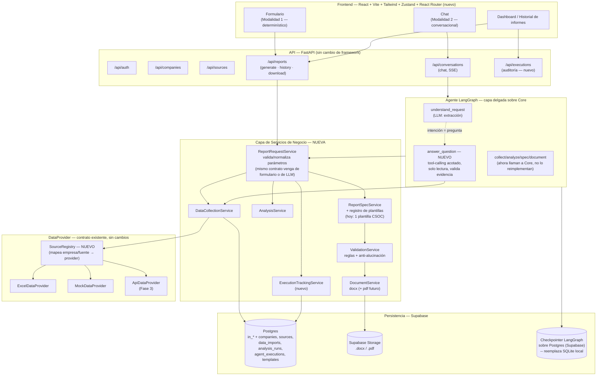
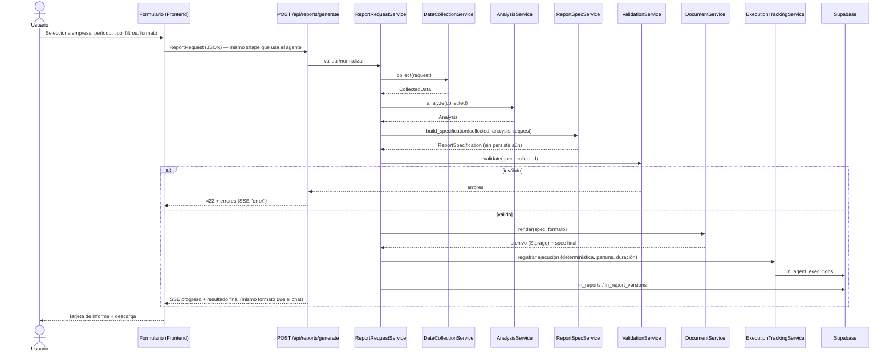
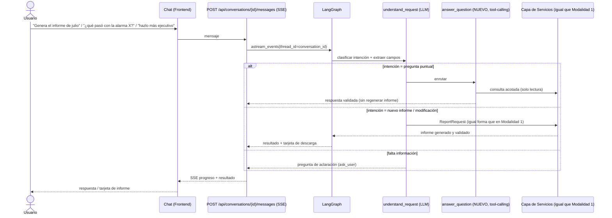
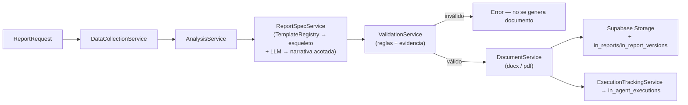
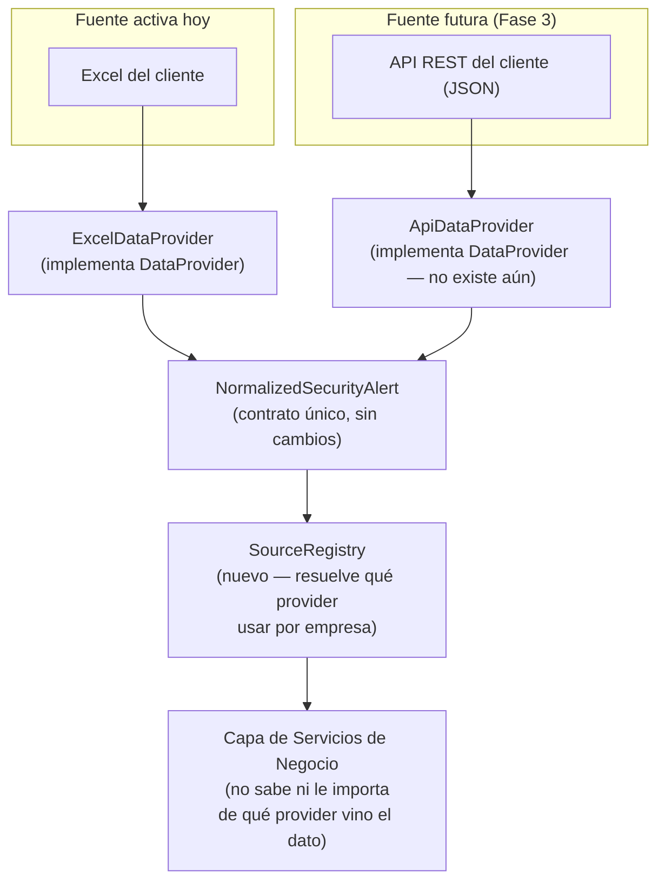

# ARCHITECTURE_TARGET.md — Fase 1: Arquitectura objetivo

> Basado exclusivamente en los hallazgos de [ARCHITECTURE_ASSESSMENT.md](ARCHITECTURE_ASSESSMENT.md)
> (Fase 0). Documento de diseño — **no se implementa código en esta fase**.

## Principio rector de esta fase

El hallazgo central de la Fase 0 es que el POC ya tiene una **buena separación de datos**
(`DataProvider`) pero **ninguna separación entre transporte y lógica de negocio**: la lógica de
recolectar datos, analizarlos, armar la especificación del informe y generarlo vive *dentro* de
nodos de LangGraph, acoplada a la forma en que el grafo pasa estado. Por eso hoy solo existe la
modalidad conversacional — no porque falte una segunda UI, sino porque no hay una capa de servicios
que un formulario pueda llamar sin pasar por el LLM.

La arquitectura objetivo resuelve esto extrayendo esa lógica a una **capa de servicios compartida**
de la que tanto el flujo determinístico como el agente conversacional son *clientes delgados*. Todo
lo demás (proveedores de datos, esquema del informe, validación anti-alucinación, persistencia en
Supabase) se conserva y se extiende — no se reemplaza, siguiendo la regla de "no reemplaces
componentes funcionales sin justificarlo".

## 1. Arquitectura propuesta

```
┌─────────────────────────────── Frontend (React SPA) ───────────────────────────────┐
│  Dashboard / Historial   │   Formulario (Modalidad 1)   │   Chat (Modalidad 2)      │
└──────────────┬───────────┴───────────────┬───────────────┴───────────┬─────────────┘
               │                           │                           │
┌──────────────┴───────────────────────────┴───────────────────────────┴─────────────┐
│                              API (FastAPI) — sin cambios de framework               │
│   /api/companies   /api/sources   /api/reports   /api/conversations   /api/executions│
└──────────────┬───────────────────────────┬───────────────────────────┬─────────────┘
               │                           │                           │
               │                  ┌────────┴────────┐          ┌──────┴──────┐
               │                  │  Agente LangGraph │          │  (directo)  │
               │                  │  (capa delgada)   │          │             │
               │                  └────────┬────────┘          └──────┬──────┘
               │                           │                          │
┌──────────────┴───────────────────────────┴──────────────────────────┴─────────────┐
│                    Capa de Servicios de Negocio (NUEVA — el cambio central)         │
│  ReportRequestService · DataCollectionService · AnalysisService · ReportSpecService │
│  (+ registro de plantillas) · ValidationService · DocumentService · ExecutionTracker│
└──────────────┬───────────────────────────────────────────────────────┬─────────────┘
               │                                                       │
┌──────────────┴──────────────────┐                    ┌───────────────┴─────────────┐
│   DataProvider (existente)       │                    │   Persistencia (Supabase)   │
│   Excel · Mock · API (futuro)    │                    │   Postgres + Storage +      │
│   vía SourceRegistry (nuevo)     │                    │   checkpointer del agente   │
└───────────────────────────────────┘                    └───────────────────────────┘
```

**Qué NO cambia:** FastAPI como framework, LangGraph como motor del agente, `DataProvider` como
contrato de fuentes, `ReportSpecification`/`docx_builder` como base del documento, Supabase como
almacén principal, React+Vite+Tailwind+Zustand en el frontend, el mecanismo SSE de progreso.

**Qué se agrega:** una capa de servicios de negocio transport-agnóstica; un registro de plantillas
de informe; persistencia del checkpointer y de los documentos dentro de Supabase; un nodo acotado
de preguntas ad-hoc con tool-calling real (única excepción al patrón determinista, justificada en
la sección 3); metadata de ejecución para auditoría; enrutamiento de frontend para dashboard/
formulario/historial.

## 2. Diagrama Mermaid



## 3. Componentes y justificación

### 3.1 Capa de servicios de negocio (el cambio central)

**Qué es:** módulos Python puros (`app/services/report/*.py`), sin dependencia de LangGraph ni de
FastAPI, que reciben y devuelven objetos Pydantic explícitos en vez de fragmentos de `ReportState`.
Son la refactorización de la lógica que hoy vive *dentro* de `collect_data`, `analyze_data`,
`generate_report_spec.py` y `generate_document.py`.

- **`ReportRequestService`**: valida y normaliza una solicitud de informe (`ReportRequest`:
  company_id, período, tipo de informe, categorías, nivel de riesgo, framework, audiencia). Es el
  punto de entrada único: el formulario le pasa un `ReportRequest` ya completo; el agente
  conversacional construye el mismo `ReportRequest` a partir de lo que `understand_request` extrajo
  turno a turno. **Esto es lo que hace que "ambos flujos compartan lógica de negocio" deje de ser
  una aspiración y sea una restricción de diseño real.**
- **`DataCollectionService`**: la lógica hoy en `collect_data` (llamadas a `security_tools`),
  extraída como función pura `async def collect(request: ReportRequest) -> CollectedData`.
- **`AnalysisService`**: la lógica hoy en `analyze_data`, sin cambios de comportamiento.
- **`ReportSpecService`**: la lógica hoy en `generate_report_spec.py`, pero con el esqueleto de
  secciones detrás de un **registro de plantillas** (`TemplateRegistry: dict[str, ReportTemplate]`)
  en vez de hardcodeado. Hoy solo se registra una plantilla (`csoc_mensual`, la actual), así que el
  comportamiento no cambia — pero el punto de extensión ya existe para cuando la Fase 5/7 necesiten
  un segundo tipo de informe, sin tocar el resto del sistema.
- **`ValidationService`**: envuelve `ReportSpecification.validate_business_rules()` y
  `.validate_evidence()` (sin cambios — ya son deterministas y reutilizables tal cual).
- **`DocumentService`**: la lógica hoy en `generate_document.py`/`docx_builder.py`, extendida para
  aceptar un formato (`docx` | `pdf`) y para escribir a Supabase Storage en vez de disco local
  (sección 6).
- **`ExecutionTrackingService`** (nuevo): registra cada ejecución (modo, usuario, parámetros,
  duración, estado, errores) en una tabla de auditoría — resuelve la brecha de observabilidad de la
  Fase 0 con el mínimo componente necesario, sin construir un sistema de métricas completo todavía
  (eso es la Fase 8).

**Por qué esta capa y no otra cosa:** es el cambio de menor riesgo que resuelve el mayor problema.
No introduce infraestructura nueva, no cambia ningún contrato externo (la API HTTP y el
comportamiento del chat pueden quedar idénticos durante el refactor), y es 100% cubierto por los
tests ya existentes si se hace con disciplina (mover código, no reescribirlo).

### 3.2 Capa de agente (LangGraph) — se adelgaza, no se reemplaza

El grafo de 9 nodos se conserva **estructuralmente igual**: sigue siendo un único `StateGraph`
lineal, sin supervisor ni subagentes (ver sección 9 — alternativas descartadas). El cambio es que
cada nodo pasa a ser un adaptador delgado que llama a la capa de servicios en vez de contener la
lógica:

```python
# Antes (hoy): la lógica vive en el nodo
async def collect_data(state: ReportState) -> dict:
    provider = get_data_provider()
    ... 40 líneas de lógica ...

# Después (objetivo): el nodo traduce estado ↔ servicio
async def collect_data(state: ReportState) -> dict:
    request = ReportRequest.from_state(state)
    collected = await DataCollectionService.collect(request)
    return {"collected_data": collected.model_dump(), "errors": collected.warnings}
```

**Único componente nuevo en el agente: el nodo `answer_question`.** La Fase 0 identificó una
brecha funcional real, no solo estructural: hoy no existe ningún camino para que el usuario
pregunte algo puntual ("cuéntame más sobre la alarma X", "¿por qué esa IP aparece tanto?") sin que
el sistema lo interprete como una solicitud de regenerar el informe completo. `understand_request`
ya clasifica `intent="other"` para estos casos pero el enrutamiento actual (`_route_after_understanding`)
lo ignora.

Esto amerita la **única excepción deliberada** al patrón "sin tool-calling real" que definió la
Fase 0: `answer_question` usa un modelo con un conjunto **acotado y de solo lectura** de
herramientas (`get_alarm_record`, `search_alerts_by_category`, ya existentes en
`security_tools.py` o triviales de agregar) para que el modelo mismo decida qué consultar según la
pregunta — porque a diferencia de "generar el informe", aquí el conjunto de datos relevante
realmente no se puede predecir de antemano. Su respuesta pasa por la misma
`ValidationService.validate_evidence()` antes de mostrarse, así que no relaja la garantía
anti-alucinación del resto del sistema — solo cubre un caso que hoy nadie cubre.

**Por qué no un supervisor ni subagentes especializados:** ninguno de los casos de uso del prompt
maestro (generar, modificar enfoque, comparar períodos, responder preguntas) requiere que un LLM
decida *entre agentes*, solo que dentro de una conversación se pueda tomar uno de un puñado de
caminos conocidos — y eso ya lo resuelve el enrutamiento condicional del grafo actual más el nuevo
nodo de preguntas. Agregar un supervisor sería complejidad sin beneficio medible, exactamente lo
que la regla 5 del proceso pide evitar.

### 3.3 Frontend

Se agregan tres piezas, todas consumiendo la misma API:

- **Dashboard/Historial** (nuevo): lista de empresas con informes, y para cada empresa el historial
  de versiones ya persistido en `in_report_versions` — hoy esa información existe en Supabase pero
  no tiene ninguna vista propia (solo aparece como tarjeta dentro de la conversación que lo generó).
- **Formulario** (nuevo, Modalidad 1): campos 1:1 con `ReportRequest` (empresa, fecha inicio/fin,
  tipo de informe, categorías, nivel de riesgo, nivel de detalle, formato de salida). Al enviar,
  llama a `POST /api/reports/generate` y consume el mismo stream de eventos de progreso (SSE) que
  ya usa el chat — mismo componente `ProgressStatus.tsx`, mismo vocabulario de eventos.
- **React Router** (nueva dependencia, justificada en la sección 9): se necesita para que
  dashboard/formulario/historial/chat sean rutas distinguibles (compartibles, recargables) en vez
  de estado interno de un único componente — hoy la SPA es una sola vista y no lo requiere.

El chat (`ChatWindow.tsx`, `Sidebar.tsx`, stores) se mantiene sin cambios estructurales — ver
sección 5.

### 3.4 Capa de datos (visión general — el diseño detallado es la Fase 2)

Se confirma la separación que pide el prompt maestro, mapeada a lo que ya existe y lo que falta:

| Categoría | Estado hoy | Objetivo |
|---|---|---|
| Datos crudos | No persistidos (solo el Excel en disco) | Registrar metadata de cada importación (Fase 2/3); el blob crudo puede quedar en Storage si se decide que vale la pena, no es obligatorio |
| Datos normalizados | Solo en memoria del proceso (`NormalizedSecurityAlert`) | A decidir en Fase 2: persistir o mantener in-memory con reconstrucción rápida — ver pregunta abierta en sección 10 |
| Datos enriquecidos | Fusionados en la normalización (MITRE, nivel de riesgo) | Igual — no separar en una etapa aparte mientras el enriquecimiento sea solo lookups estáticos |
| Resultados de análisis | Efímeros (viven solo durante una ejecución del grafo) | Persistir un snapshot por ejecución vía `ExecutionTrackingService` |
| Informes generados | `in_reports`/`in_report_versions` (Supabase) + archivo en disco local | Igual + archivo en Supabase Storage |
| Metadata de ejecuciones | No existe | Nueva tabla `in_agent_executions` (o `in_executions`) |

### 3.5 Integraciones / fuentes de datos

Se conserva `DataProvider` como contrato único. Se agrega un **`SourceRegistry`** liviano: hoy
`get_data_provider()` es una función global que lee una única variable de entorno
(`DATA_PROVIDER=excel|mock`); el objetivo permite que la fuente se resuelva **por empresa/cliente**
(una vez que exista la entidad `companies`/`data_sources` de la Fase 2), sin cambiar el contrato de
`DataProvider` en absoluto. El detalle de conectores Excel/API es el contenido completo de la
Fase 3 — aquí solo se fija el punto de extensión.

## 4. Flujo determinístico (Modalidad 1 — nuevo)



**Reproducibilidad:** dado el mismo `ReportRequest` y el mismo estado de los datos fuente, la salida
es determinista **por construcción** — no hay ningún paso de este flujo que dependa de una decisión
del LLM (a diferencia del flujo conversacional, donde `understand_request` sí interviene). Esto
cumple literalmente el requisito "la misma entrada debería producir resultados consistentes" del
prompt maestro sin necesitar ningún mecanismo especial de determinismo — es una consecuencia directa
de no invocar el modelo en este camino.

## 5. Flujo conversacional (Modalidad 2 — evoluciona, no se reescribe)



Lo único que cambia respecto al comportamiento actual: (a) los nodos llaman a la capa de servicios
en vez de reimplementar lógica, y (b) existe un camino real para preguntas puntuales. El resto del
comportamiento ya descrito en la Fase 0 (reutilizar `collected_data` cuando el usuario solo pide un
cambio de tono, aclarar cuando falta empresa/período) se conserva sin modificación de
comportamiento observable.

## 6. Flujo de generación de informes (núcleo compartido)

Este es el flujo que las secciones 4 y 5 tienen en común — es, literalmente, el cuerpo de la capa de
servicios de negocio:



Tanto el endpoint determinístico como el nodo del agente invocan exactamente esta cadena — la única
diferencia entre ambos flujos es **quién construye el `ReportRequest` inicial** (un formulario, o
`understand_request` a partir de lenguaje natural).

## 7. Flujo de incorporación de nuevas fuentes



Agregar una fuente nueva significa: (1) implementar `DataProvider` para ella, (2) registrar la
instancia en `SourceRegistry` para las empresas que la usan. **Cero cambios** en `tools/`, en la
capa de servicios, en el agente, ni en el frontend — exactamente el criterio de éxito que pide la
Fase 3. El detalle de parsers/validadores específicos por formato es contenido de la Fase 3, no de
este documento.

## 8. Decisiones arquitectónicas

1. **Extraer una capa de servicios en vez de reescribir el agente.** Menor riesgo, reutiliza tests
   existentes, y es la única forma de que ambas modalidades compartan lógica de verdad (no solo en
   la intención, sino en el código ejecutado).
2. **Mantener un único grafo LangGraph, sin supervisor ni subagentes.** Justificado en 3.2 y
   ampliado en la sección 9.
3. **Una sola excepción de tool-calling real (`answer_question`), acotada y validada.** Resuelve una
   brecha funcional genuina sin comprometer la garantía anti-alucinación del resto del sistema.
4. **Registro de plantillas (`TemplateRegistry`) con una sola plantilla activa por ahora.** Fija el
   punto de extensión sin construir tipos de informe que nadie pidió todavía (Fase 5 decide si se
   necesitan más).
5. **Migrar el checkpointer del agente y los documentos generados a Supabase.** Resuelve los dos
   riesgos de mayor severidad identificados en la Fase 0 (pérdida de estado/archivos al escalar o
   redesplegar). Implementación detallada en Fase 2 (esquema) y Fase 4/7 (código).
6. **Agregar React Router al frontend.** Única dependencia nueva de esta fase; justificada porque
   dashboard/formulario/historial necesitan ser rutas reales, no estado de un solo componente.
7. **Las firmas de los servicios de negocio incluyen `organization_id`/`requested_by` desde ahora**,
   aunque hoy solo exista un usuario hardcodeado — evita un refactor invasivo cuando la Fase 9
   implemente autorización real.

## 9. Alternativas descartadas

| Alternativa | Por qué se descarta (por ahora) |
|---|---|
| Arquitectura multi-agente con supervisor y subagentes especializados | Ningún caso de uso del prompt maestro requiere que un LLM elija *entre agentes* — el enrutamiento condicional del grafo actual, más el nuevo nodo acotado de preguntas, cubre todos los casos descritos. Agregar supervisor sería complejidad sin beneficio medible (regla 5 del proceso: evitar sobreingeniería). |
| Pipeline asíncrono basado en colas (Celery/RabbitMQ/SQS) para generación de informes | El volumen actual es bajo (generación bajo demanda, no miles de informes concurrentes); SSE + ejecución síncrona por request ya funciona y está probado. Reconsiderar si la concurrencia real lo exige. |
| Microservicios separados (ingestión, agente, generación de documentos como despliegues independientes) | El monolito modular con capas de código bien separadas logra bajo acoplamiento sin el costo operativo (orquestación, redes, versionado de contratos entre servicios) que nada en los requisitos actuales justifica. |
| Motor de plantillas genérico / DSL (ej. Jinja sobre XML de docx) en vez de `ReportTemplate` como función Python | Con un solo tipo de informe activo, una función Python explícita es más simple de depurar y de validar con tests que un DSL nuevo. Reconsiderar si el catálogo de tipos de informe crece más allá de 3-4. |
| Reemplazar el cliente PostgREST manual (`supabase_rest.py` + `httpx`) por el SDK oficial `supabase-py` | El cliente actual ya cubre las operaciones CRUD necesarias sin dependencia nueva. Reconsiderar solo si se necesita una capacidad específica del SDK (ej. Realtime, manejo de sesiones de Supabase Auth) que valga el costo de la migración. |
| Base de datos vectorial / RAG | Ya evaluado en esta misma conversación: no existe corpus no estructurado (playbooks, informes históricos en texto libre) que lo justifique hoy. |
| Tool-calling real en todo el agente (no solo en `answer_question`) | La Fase 0 encontró que el pipeline determinista es una fortaleza de confiabilidad y reproducibilidad, no una limitación a corregir. Generalizar tool-calling introduciría la misma superficie de alucinación que el resto del sistema evita deliberadamente, a cambio de una flexibilidad que ningún caso de uso pide hoy. |

## 10. Riesgos y mitigaciones

| Riesgo | Mitigación |
|---|---|
| Migrar el checkpointer a Postgres agrega latencia de red por nodo (hoy SQLite local es instantáneo) | Medir antes/después; Supabase Postgres en la misma región suele ser <50ms; evaluar pooling (Supabase ya ofrece pgbouncer) antes de descartar el cambio. |
| El refactor "nodos → capa de servicios" puede introducir regresiones silenciosas si se reescribe en vez de mover código | El refactor debe ser mecánico (extraer función, no reescribir lógica) y correr la suite de 53 tests existente en cada paso — ninguno de esos tests debería requerir cambios si el comportamiento observable no cambia. |
| El nuevo nodo `answer_question` reintroduce superficie de alucinación | Tools de solo lectura, sin escritura; respuesta pasa por `ValidationService.validate_evidence()` antes de mostrarse — mismo mecanismo que ya protege el resto del sistema. |
| Cambiar el origen de los archivos de disco a Supabase Storage rompe la descarga | El endpoint `/api/reports/{id}/download` se mantiene como fachada estable; el frontend ya usa fetch+blob autenticado (cambio de la sesión anterior), así que el origen del archivo es un detalle interno invisible para el cliente. |
| Agregar React Router sin necesidad real | Se limita a las 2-3 rutas que realmente lo justifican (dashboard, formulario, chat); no se introduce como reescritura general de la navegación. |
| La capa de servicios nueva queda como una capa "de paso" sin valor si no se le exige disciplina (nodos que la bypasean) | Se fija como regla de diseño para la Fase 4: ningún nodo del grafo debe contener lógica de negocio propia — solo traducción estado↔servicio. Se puede verificar con revisión de código, no requiere tooling nuevo. |
| Multiempresa/multiusuario mal delimitado desde el inicio | Firmas de servicio con `organization_id`/`requested_by` explícitos desde la Fase 4, aunque la autorización real llegue recién en la Fase 9 — evita repetir el refactor. |

---

**Fin de la Fase 1.** No se implementó código. Quedo a la espera de aprobación para iniciar la
Fase 2 (diseño del modelo de datos y Supabase), que es donde se decide en detalle el esquema de las
tablas nuevas mencionadas aquí (`companies`, `data_sources`, `data_imports`, `analysis_runs`,
`in_agent_executions`, `templates`) y la pregunta abierta de si persistir o no las alertas
normalizadas.
