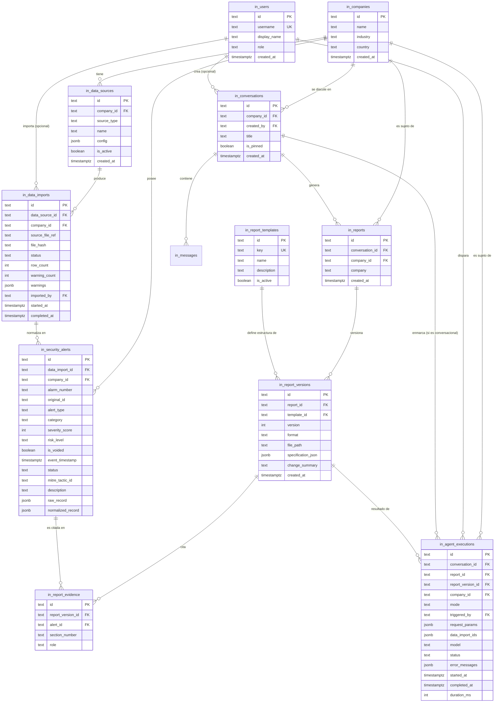

# DATA_MODEL.md — Fase 2: Modelo de datos y Supabase

> Basado en [ARCHITECTURE_ASSESSMENT.md](ARCHITECTURE_ASSESSMENT.md) (Fase 0) y
> [ARCHITECTURE_TARGET.md](ARCHITECTURE_TARGET.md) (Fase 1). Documento de diseño — **no se ejecuta
> ninguna migración en esta fase**. El SQL completo vive en [supabase_schema.sql](supabase_schema.sql)
> como entregable, listo para revisión, no para aplicar todavía.

## 0. Punto de partida: lo que ya existe

En una sesión anterior ya se creó en Supabase el primer lote de tablas `in_*` (prefijo acordado
para no colisionar con otros proyectos en el mismo Supabase compartido), con RLS habilitado y una
política que da acceso completo únicamente a la clave `anon`, usada solo por el backend
(nunca expuesta al navegador):

| Tabla | Columnas actuales |
|---|---|
| `in_conversations` | `id, title, is_pinned, created_at` |
| `in_messages` | `id, conversation_id→in_conversations, role, content, created_at` |
| `in_reports` | `id, conversation_id→in_conversations, company, created_at` |
| `in_report_versions` | `id, report_id→in_reports, version, file_path, specification_json, change_summary, created_at` |

Este documento **extiende** ese esquema — no lo reemplaza. Todas las tablas nuevas siguen el mismo
prefijo `in_`, el mismo estilo de PK (texto generado en la app, no UUID de Postgres), y el mismo
patrón de RLS.

## 1. Entidades evaluadas y decisión

El prompt maestro pide evaluar 15 entidades candidatas. Siguiendo la regla "no crees tablas
innecesarias", cada una se evalúa contra un requisito concreto de la Fase 0/1 — no se crea ninguna
por completitud teórica.

| Entidad candidata | Decisión | Por qué |
|---|---|---|
| Organizations | **No crear** | El sistema es single-tenant a nivel de proveedor SOC (una sola instalación de la app por proveedor). "Company" ya es el límite multiempresa que pide el negocio ("informe para una empresa específica"). Agregar una capa "Organization" por encima de "Company" sería modelar un escenario (múltiples proveedores SOC en la misma instancia) que nadie pidió. |
| **Companies** | ✅ Crear (`in_companies`) | Hoy "empresa" es un string derivado del Excel (`cliente`), sin identidad propia. Es el ancla de multiempresa que la Fase 1 asume en las firmas de servicio (`company_id`). |
| **Users** | ✅ Crear (`in_users`), liviana | No es Supabase Auth (la Fase 1 decidió mantener el login único, ver §5). Es una tabla de referencia mínima para poder responder "¿qué usuario generó este informe?" (requisito explícito de Fase 5/8), con una sola fila sembrada hoy (`master`). |
| **Data Sources** | ✅ Crear (`in_data_sources`) | Es el ancla del `SourceRegistry` diseñado en la Fase 1 — sin esto no hay dónde registrar "esta empresa usa este Excel / esta API". |
| **Data Imports** | ✅ Crear (`in_data_imports`) | Cierra la brecha de la Fase 0: hoy no hay forma de saber qué versión del Excel generó un informe dado. |
| Raw Data | **No crear tabla dedicada** | En vez de una tabla `raw_data` separada, el archivo original se referencia desde `in_data_imports.source_file_ref` (ruta en Supabase Storage) y cada fila de `in_security_alerts` guarda su `raw_record` original en una columna `jsonb`. Esto da trazabilidad al dato crudo sin duplicar una tabla completa de filas sin normalizar. |
| **Normalized Events / Alerts** | ✅ Crear (`in_security_alerts`) | Ver justificación detallada en §2 — es la decisión de mayor impacto de esta fase. |
| Notifications / Emails | **No crear** | El `DataProvider` actual (`ExcelDataProvider.get_notifications`) ya devuelve lista vacía porque el Excel real no tiene un log de notificaciones separado — persistir una entidad sin fuente de datos real sería especulativo. La información de correo que sí existe (rareza, fuga de datos) ya queda cubierta dentro de `in_security_alerts` (categoría) y en los campos calculados del informe. Se reconsidera si una fuente futura (Fase 3) trae un feed de notificaciones real. |
| **Analysis Runs** + **Agent Executions** | ✅ Crear, **fusionadas** en una sola tabla (`in_agent_executions`) | Son el mismo concepto visto desde dos nombres: una ejecución del pipeline de generación (determinística o conversacional). Crear dos tablas separadas duplicaría casi todas las columnas (empresa, período, estado, duración) sin una razón real para separarlas. |
| Reports / Report Versions | Ya existen | Se extienden con columnas nuevas, no se rediseñan (§4). |
| **Report Sections** | **No crear tabla dedicada** | Las secciones ya son un árbol Pydantic validado (`ReportSpecification.sections`) que se persiste completo como `specification_json` (jsonb) en `in_report_versions` — normalizarlo en filas (`sections`, `subsections`, `tables`...) añadiría varias tablas y joins recursivos sin un caso de uso que hoy los necesite (nadie consulta "dame todas las secciones 6.3 de todos los informes" de forma independiente del informe completo). Se reconsidera si aparece ese caso de uso real. |
| Conversations / Messages | Ya existen | Se extienden levemente (§4). |
| **Templates** | ✅ Crear (`in_report_templates`), liviana | Respalda el `TemplateRegistry` de la Fase 1. Guarda solo metadata (clave, nombre, activo/inactivo) — la lógica de armado de secciones sigue siendo código Python, no una plantilla almacenada en base de datos (se descartó un motor de plantillas en la Fase 1). |
| Audit Logs (genérico) | **No crear todavía** | `in_agent_executions` ya cubre el requisito explícito de auditoría de esta fase (qué datos, qué usuario, qué modelo, cuándo). Un log de auditoría genérico para acciones CRUD (quién renombró/borró una conversación) es un alcance de la Fase 9 (seguridad), no de la Fase 2 — se deja documentado como pendiente en vez de construirlo sin un requisito concreto todavía. |

Tabla adicional no listada explícitamente en el prompt maestro pero necesaria para cumplir
literalmente "relación entre informes y datos utilizados":

| Entidad | Decisión |
|---|---|
| **Report Evidence** (`in_report_evidence`) | ✅ Crear, marcada como **opcional para el MVP de la Fase 4** — une `in_report_versions` con `in_security_alerts` fila por fila (qué alarma sustenta qué sección/recomendación). Es barata (unas pocas filas por informe) y responde directamente "¿qué datos usó este informe?" a nivel de fila en vez de solo "en algún lugar del JSON". Se documenta ahora para no rediseñar el esquema más adelante, pero poblarla no bloquea la migración inicial (ver §6). |

## 2. La decisión de mayor impacto: persistir `in_security_alerts`

Hoy los datos normalizados (`NormalizedSecurityAlert`) existen **solo en memoria** del proceso
backend, reconstruidos desde el Excel cada vez que arranca (`@lru_cache` en
`get_data_provider()`). Esta fase decide **sí persistirlos** en Supabase, con esta justificación
explícita (para que la Fase 4 no tenga que volver a discutirlo):

**A favor:**
- Es la única forma de que "relación entre informes y datos utilizados" (requisito explícito) sea
  una consulta real y no una inspección manual del `specification_json`.
- Habilita filtrado por período a nivel de base de datos (`WHERE company_id = ? AND
  event_timestamp BETWEEN ? AND ?`) en vez de cargar todo el Excel en memoria por request.
- Es indispensable para "reprocesamiento": volver a analizar un período sin re-parsear el Excel.
- Uniforma el comportamiento entre `ExcelDataProvider` y un futuro `ApiDataProvider` — ambos
  terminan escribiendo a la misma tabla, y las consultas de "tools" pueden, con el tiempo, leer de
  Postgres en vez de la estructura en memoria de cada provider (esto es una decisión de
  implementación de la Fase 4, no de esta fase — aquí solo se habilita).

**En contra (riesgos reconocidos, con mitigación):**
- Riesgo de que la copia persistida quede desincronizada de la fuente real. *Mitigación:* cada fila
  se ata a un `data_import_id` inmutable — nunca se hace `UPDATE` de una alerta ya importada, una
  reimportación crea un nuevo `data_import` con sus propias filas (ver §6, estrategia de
  reprocesamiento).
- Costo de escritura adicional en cada ingesta. *Mitigación:* al volumen actual (170 filas/mes por
  empresa) es insignificante; ver §7 (escalabilidad) si esto cambia de orden de magnitud.
- Duplicación de responsabilidad de "qué es la fuente de verdad". *Mitigación:* el Excel/API sigue
  siendo la fuente de verdad de negocio; `in_security_alerts` es una **copia de trabajo
  trazable**, nunca editable manualmente, siempre reproducible desde `raw_record`.

## 3. Diagrama ER

## 4. Extensiones a tablas existentes

Ninguna columna existente se elimina ni se renombra — solo se agregan columnas **nulas por
defecto**, así el código actual sigue funcionando sin cambios hasta que la Fase 4 lo actualice para
usarlas:

- `in_conversations`: + `company_id` (text, FK nullable — se completa cuando el agente identifica
  la empresa), + `created_by` (text, FK nullable → `in_users`).
- `in_reports`: + `company_id` (text, FK nullable — el campo `company` de texto libre se conserva
  para no romper lecturas actuales; `company_id` es la referencia normalizada nueva).
- `in_report_versions`: + `template_id` (text, FK nullable → `in_report_templates`), + `format`
  (text, default `'docx'`, check `in ('docx','pdf')`).

## 5. Estrategia de persistencia

- **Postgres (Supabase) es el único almacén de datos de negocio** — se mantiene la decisión ya
  tomada, sin introducir otro motor de base de datos.
- **El checkpointer del agente (LangGraph) migra de SQLite local a Postgres** usando el saver
  oficial `langgraph-checkpoint-postgres` contra la misma instancia de Supabase — resuelve el
  riesgo de mayor severidad de la Fase 0 (pérdida de estado del agente al escalar/redesplegar). Esto
  usa sus propias tablas internas (`checkpoints`, `checkpoint_writes`, gestionadas por la librería,
  no por este esquema) — se documenta aquí como decisión pero el DDL no es responsabilidad de este
  documento (lo gestiona la librería al inicializarse).
- **Los documentos generados (.docx, futuro .pdf) migran a Supabase Storage**, en un bucket
  `reports` (no público, acceso solo vía backend). `in_report_versions.file_path` pasa a contener
  la ruta dentro del bucket en vez de una ruta de disco local — el endpoint de descarga
  (`/api/reports/{id}/download`) ya es una fachada estable (fetch+blob autenticado desde la sesión
  anterior), así que este cambio es invisible para el frontend.
- **Datos crudos:** el archivo Excel/JSON original de cada importación se sube también a Storage
  (bucket `data-sources`, no público) y se referencia desde `in_data_imports.source_file_ref` —
  cumple "preservar información original" sin duplicar cada fila cruda en Postgres.
- **`in_users` no es `auth.users` de Supabase.** Es una tabla de aplicación simple, coherente con
  la decisión de la Fase 1 de mantener el login único (`master`/`123456`) en vez de adoptar
  Supabase Auth para un solo usuario. Si la Fase 9 introduce usuarios reales, la migración natural
  es que `in_users.id` empiece a coincidir con `auth.users.id` — el esquema ya lo permite (es un
  `text` libre) sin requerir un rediseño.

## 6. Estrategia de versionamiento y reprocesamiento

- **Informes:** sin cambios respecto al mecanismo ya implementado — `in_report_versions.version`
  autoincremental por `report_id`, cada regeneración crea una fila nueva, nunca se sobreescribe una
  versión anterior. Se le suma `template_id` para saber qué plantilla produjo cada versión (relevante
  el día que exista más de una).
- **Datos importados:** cada corrida de ingesta crea una fila nueva en `in_data_imports` — **nunca
  se actualiza una importación anterior**. Reimportar el mismo Excel (aunque no haya cambiado) es
  válido y trazable; `file_hash` permite detectar y, opcionalmente, evitar reimportar un archivo
  idéntico byte a byte (decisión de aplicación en la Fase 4, no una restricción del esquema).
- **Alertas:** cada fila de `in_security_alerts` pertenece a exactamente un `data_import_id` y
  nunca se edita in-place. "Reprocesar" un período significa: nueva importación → nuevas filas →
  las consultas de análisis usan la importación más reciente de cada empresa por defecto, pero
  pueden apuntar a una importación específica para reproducir un informe histórico exactamente como
  se generó (trazabilidad completa).
- **`in_agent_executions.data_import_ids`** registra exactamente qué importación(es) alimentaron
  cada ejecución — así un informe generado hoy y otro generado mañana sobre "el mismo período" son
  distinguibles si el dato de origen cambió entre medio.

## 7. Estrategia de seguridad

- **RLS se mantiene en todas las tablas nuevas**, con la misma política que las tablas existentes:
  acceso completo solo para el rol `anon`, y esa clave vive únicamente en `backend/.env` (nunca en
  el frontend). Esto sigue siendo una barrera de "solo el backend puede tocar estas tablas", no
  todavía una barrera de aislamiento por cliente/usuario dentro del backend — ese nivel de RLS
  (basado en `auth.uid()` real) requiere que existan usuarios reales de Supabase Auth, lo cual la
  Fase 1 decidió no adoptar aún. **Se deja explícitamente documentado como trabajo de la Fase 9**,
  no de esta fase.
- **`in_data_sources.config` (jsonb) nunca debe contener secretos en texto plano** (API keys,
  tokens de fuentes futuras) — si una fuente futura los necesita, `config` guarda una referencia
  (nombre de variable de entorno o de un secreto gestionado), y el valor real vive en
  `backend/.env` o, si se adopta más adelante, en Supabase Vault. Se documenta como regla de diseño
  para la Fase 3, no como algo que el esquema por sí mismo pueda garantizar.
- **Buckets de Storage no públicos** (`reports`, `data-sources`) — el acceso siempre pasa por el
  backend autenticado, igual que hoy con los archivos en disco.
- **Clasificación de datos:** las alertas de seguridad (hostnames, IPs, descripciones) son
  información confidencial del cliente aunque no sean datos personales — ya se refleja en el
  informe (`clasificacion: "CONFIDENCIAL"`); no se propone ningún cambio de tratamiento en esta
  fase, solo se nota que `in_security_alerts` hereda esa misma sensibilidad y debe quedar cubierta
  por el mismo perímetro de acceso que el resto de `in_*`.

## 8. Consideraciones de escalabilidad

- **Volumen actual:** ~170 alarmas/mes para un cliente. Incluso con decenas de empresas y varios
  años de historial, `in_security_alerts` se mantiene en el orden de cientos de miles de filas —
  trivial para Postgres sin particionamiento ni índices especiales más allá de los básicos.
- **Índices previstos** (incluidos en `supabase_schema.sql`): `(company_id, event_timestamp)` sobre
  `in_security_alerts` — es el patrón de consulta central ("alertas de esta empresa en este
  período"); `(company_id, risk_level)` para filtrado por severidad; índice único en
  `in_report_templates.key` y `in_users.username`.
- **Si el volumen creciera en órdenes de magnitud** (ingestas de API de alta frecuencia en vez de
  un Excel mensual), sería el momento de evaluar particionamiento por fecha en
  `in_security_alerts` — no se implementa preventivamente ahora (evitar sobreingeniería).
- **`raw_record`/`normalized_record` (jsonb) por fila** son razonables al tamaño actual de cada
  alerta individual (registro de una fila de Excel, no un payload masivo). Si una fuente futura
  (Fase 3) trajera payloads JSON grandes por evento, la recomendación es subir el payload completo a
  Storage y guardar solo una referencia en la fila — no forzar cualquier tamaño de payload dentro de
  Postgres. Se deja como guía para la Fase 3, no como regla aplicada hoy.

## 9. Estrategia de migración segura

Regla dura de esta fase: **no se ejecuta ningún `apply_migration`/`execute_sql` contra Supabase, y
no se destruye ni modifica ninguna tabla existente.** `supabase_schema.sql` es 100% aditivo:

- Todas las tablas nuevas usan `CREATE TABLE IF NOT EXISTS`.
- Todas las columnas nuevas en tablas existentes usan `ALTER TABLE ... ADD COLUMN IF NOT EXISTS`,
  siempre `NULL`-ables o con `DEFAULT`, nunca `NOT NULL` sin default sobre una tabla que ya tiene
  filas.
- Ninguna sentencia `DROP`, `RENAME` ni `ALTER COLUMN ... TYPE` aparece en el script.
- El script es **idempotente**: correrlo dos veces no falla ni duplica nada (igual que el patrón ya
  usado en la migración original).
- **Orden de aplicación sugerido cuando se apruebe** (Fase 4, no ahora): 1) tablas sin
  dependencias (`in_companies`, `in_users`, `in_report_templates`) → 2) tablas que dependen de esas
  (`in_data_sources`, columnas nuevas en `in_conversations`/`in_reports`/`in_report_versions`) →
  3) tablas que dependen de las anteriores (`in_data_imports`) → 4) tablas que dependen de todo lo
  anterior (`in_security_alerts`, `in_agent_executions`, `in_report_evidence`). El archivo SQL ya
  respeta este orden.
- **Backfill de datos existentes:** las filas ya existentes en `in_reports`/`in_conversations`
  quedarán con `company_id = NULL` hasta que un script de backfill (Fase 4) las asocie por nombre
  de empresa — no es parte de este entregable porque implica ejecutar código, no solo DDL.

---

**Fin del diseño de datos de la Fase 2.** El SQL completo está en `supabase_schema.sql`, preparado
para revisión. No se aplicó ninguna migración. Quedo a la espera de aprobación para iniciar la
Fase 3 (arquitectura de ingesta y normalización de datos).
