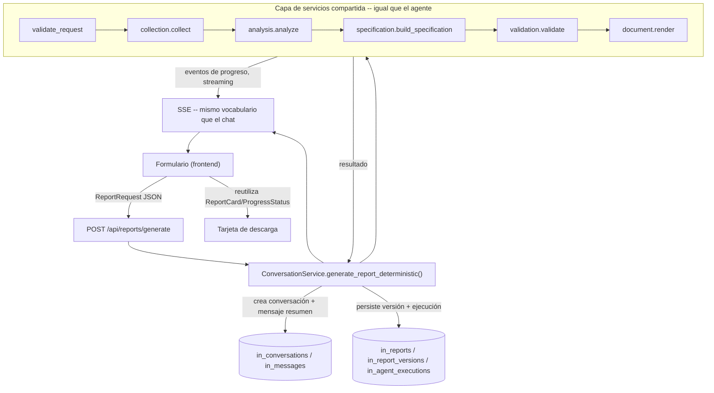

# DETERMINISTIC_FLOW.md — Fase 5: Flujo determinístico de informes

> Basado en [ARCHITECTURE_TARGET.md](ARCHITECTURE_TARGET.md) (Fase 1) y
> [AGENT_ARCHITECTURE.md](AGENT_ARCHITECTURE.md) (Fase 4), que ya dejó lista la capa de servicios
> compartida (`app/services/report/*.py`) precisamente para esta fase. Implementada de punta a
> punta (backend + frontend + Supabase), verificada en vivo contra infraestructura real.
> 87/87 tests de backend pasan (75 antes de esta fase + 12 nuevos), frontend sin errores de tipos.

## 1. Arquitectura

La Modalidad 1 (formulario) es un **segundo cliente delgado de la misma capa de servicios** que ya
usa el agente conversacional — no un pipeline paralelo. La pieza nueva es
`app/services/report/pipeline.py::run_deterministic()`, un generador asíncrono que llama, en orden
fijo, exactamente las mismas funciones que los nodos del grafo llaman (`collection.collect()`,
`analysis.analyze()`, `specification.build_specification()`, `validation.validate()`,
`document.render()`) — **sin pasar por LangGraph en absoluto**: no hay memoria de conversación que
gestionar ni ninguna decisión de "qué paso sigue" que tomar, así que el motor de grafos no aporta
nada aquí, solo overhead.



**Por qué una conversación como ancla de persistencia:** en vez de diseñar un esquema de datos
paralelo para "ejecuciones sin chat", cada generación por formulario crea una fila normal en
`in_conversations` (título descriptivo, ej. "Informe — THOMAS TGS-TPS — 2026-07-01 a 2026-07-31")
con un mensaje de usuario sintético que resume los parámetros exactos usados. Esto significa que
`in_reports`/`in_report_versions`, el endpoint de descarga, y — crucialmente — **el historial de
informes** no necesitaron ni un cambio de esquema ni un componente de frontend nuevo: la lista de
conversaciones del Sidebar (ya construida en fases anteriores) ya es el historial de la Modalidad
1, verificado en vivo (ver §5).

## 2. Flujo (los 10 pasos del prompt maestro, mapeados al código real)

| # | Paso | Dónde vive |
|---|---|---|
| 1 | Validar parámetros | `pipeline.validate_request()` — fechas válidas, empresa presente, `report_type`/`format` reconocidos. Sin I/O; si falla, ni siquiera se llama al DataProvider |
| 2 | Consultar datos | `collection.collect()` — igual que el nodo `collect_data` |
| 3 | Ejecutar análisis | `analysis.analyze()` — igual que el nodo `analyze_data` |
| 4 | Generar estructura del informe | `templates.get_template()` dentro de `specification.build_specification()` |
| 5 | Generar contenido | La misma llamada LLM de `narrative.generate_narrative()` (única llamada al modelo en todo el flujo) |
| 6 | Validar contenido | `validation.validate()` — mismas reglas de negocio + anti-alucinación de siempre |
| 7 | Crear documento | `document.render()` |
| 8 | Persistir ejecución | `ExecutionTrackingService`, `mode="deterministic"` — misma tabla `in_agent_executions` que ya usa el chat |
| 9 | Guardar informe | `in_reports`/`in_report_versions`, mismo repositorio que el chat |
| 10 | Permitir descarga | Mismo endpoint `GET /api/reports/{id}/download`, sin cambios |

## 3. Contratos

**`ReportRequest`** (`app/services/report/request.py`, ya existía desde la Fase 4) es también el
cuerpo HTTP de `POST /api/reports/generate` — no se creó un DTO paralelo: el mismo modelo que
`understand_request` construye a partir del chat es el que el formulario envía directo.

```
POST /api/reports/generate
{
  "company": "THOMAS TGS-TPS",
  "start_date": "2026-07-01",
  "end_date": "2026-07-31",
  "report_type": "csoc_mensual",   // opcional, default = plantilla activa
  "audience": "ejecutivo",         // "nivel de detalle" del formulario
  "focus_categories": ["Agente desconectado"],  // opcional
  "risk_level_filter": ["Critico", "Alto"],     // opcional
  "format": "docx"                 // único valor soportado hoy
}
```

Respuesta: **SSE**, mismo vocabulario `{"event": "progress"/"result", ...}` que
`POST /api/conversations/{id}/messages` ya usa para el chat — el frontend reutiliza literalmente el
mismo componente (`ProgressStatus.tsx`) y el mismo tipo (`StreamEvent`) para ambas modalidades.

Endpoints nuevos de apoyo (`app/api/reference_data.py`): `GET /api/companies` (lee `in_companies`,
poblada desde la Fase 3 por la ingesta) y `GET /api/report-templates` (lee `in_report_templates`,
poblada desde la Fase 4) — alimentan los selectores del formulario sin listas hardcodeadas en el
frontend.

## 4. Reproducibilidad — qué se garantiza y qué no

Dado el mismo `ReportRequest` y los mismos datos de origen: **la estructura, las tablas, las cifras
y qué alarmas se citan son 100% deterministas** — ningún paso de `run_deterministic()` depende de
una decisión del LLM sobre *qué* hacer (a diferencia del chat, donde `understand_request` sí
decide). La **prosa narrativa** (los 7 párrafos cortos que escribe `generate_narrative`) puede
variar levemente en su redacción entre dos ejecuciones idénticas, porque sigue siendo una llamada a
un modelo con muestreo — esto ya era cierto para el flujo conversacional y no es una limitación
nueva de esta fase. Se documenta explícitamente en vez de sobre-prometer "reproducible" a nivel de
byte.

## 5. Casos de error (verificados con tests, no solo diseñados)

- **Parámetros inválidos** (fecha inicial posterior a la final, `report_type` desconocido,
  `format="pdf"`): se detectan en `validate_request()` **antes de cualquier I/O** — no se consulta
  el proveedor de datos ni se llama al LLM. Probado explícitamente
  (`test_run_deterministic_param_errors_short_circuit_before_any_io`).
- **Empresa no encontrada**: mismo `CompanyNotFoundError` que ya usa el chat: mensaje claro, sin
  generar nada.
- **Validación de evidencia fallida**: mismo mecanismo que el chat — el documento simplemente no
  se genera, el error se muestra tal cual.
- **`format="pdf"`**: rechazado explícitamente con un mensaje claro ("aún no disponible") — no se
  ignora silenciosamente el formato pedido. El selector del formulario ya muestra "PDF
  (próximamente)" deshabilitado, así que un usuario normal ni siquiera puede enviarlo por error.

## 6. Limitación conocida heredada (no introducida por esta fase)

Al reabrir una conversación generada por formulario desde el Sidebar, el mensaje aparece pero **la
tarjeta de descarga del informe no se reconstruye** — es la misma brecha ya detectada antes de esta
sesión de trabajo para el flujo conversacional (`useConversationStore.selectConversation()` nunca
adjunta `report` a los mensajes cargados desde el historial, solo a los que llegan en vivo por
SSE). Afecta a **ambas modalidades por igual** y no es responsabilidad de esta fase corregirla,
pero queda documentada aquí para no perderla de vista — el usuario sí puede volver a descargar el
mismo informe desde `GET /api/reports/{report_id}/download` con el `report_id` ya conocido, la
limitación es solo de reconstrucción visual de la tarjeta al recargar.

## 7. Pruebas

- **`test_pipeline.py`** (7 tests): `validate_request()` para cada caso de error, y
  `run_deterministic()` de punta a punta con LLM stub — sin FastAPI ni Supabase de por medio.
- **`test_reports_api.py`** (5 tests, **nuevos en el repositorio**: primera cobertura HTTP real,
  cerrando una brecha marcada explícitamente en `ARCHITECTURE_ASSESSMENT.md`): usa
  `fastapi.testclient.TestClient` contra la app real, con Supabase mockeado (mismo patrón que
  `test_ingestion_service.py`) y el LLM stubbeado — cubre login, listar empresas/plantillas,
  generar-y-descargar de punta a punta, empresa inexistente, y formato no soportado.
- **Verificado en vivo** (no solo mockeado): contra la API real de Anthropic, el Excel real del
  cliente y Supabase real — generación completa (8 secciones, 67 KB de `.docx` válido), descarga
  exitosa, fila real en `in_agent_executions` con `mode=deterministic`. Verificado también en el
  navegador real: formulario completo, selectores poblados desde el backend, progreso en vivo,
  tarjeta de descarga, y la conversación resultante apareciendo automáticamente en el Sidebar.

Un efecto colateral útil de escribir `test_reports_api.py`: expuso que el fake de Supabase usado en
otras pruebas debía devolver copias (no referencias) de las filas — `ReportRepository.add_version`
muta el diccionario que recibe (`row.pop("specification_json")`), y devolver el mismo objeto
guardado internamente producía un `KeyError` en una lectura posterior. No es un bug de producción
(PostgREST siempre entrega JSON fresco), pero corregirlo hizo el fake más fiel al comportamiento
real.

---

**Fin de la Fase 5.** Backend: 87/87 tests. Frontend: `tsc --noEmit` limpio, 4/4 tests, verificado
visualmente en el navegador con generación real. Quedo a la espera de tu aprobación para iniciar la
Fase 6 (mejora de la experiencia conversacional).
