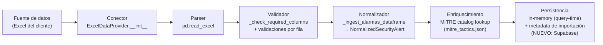
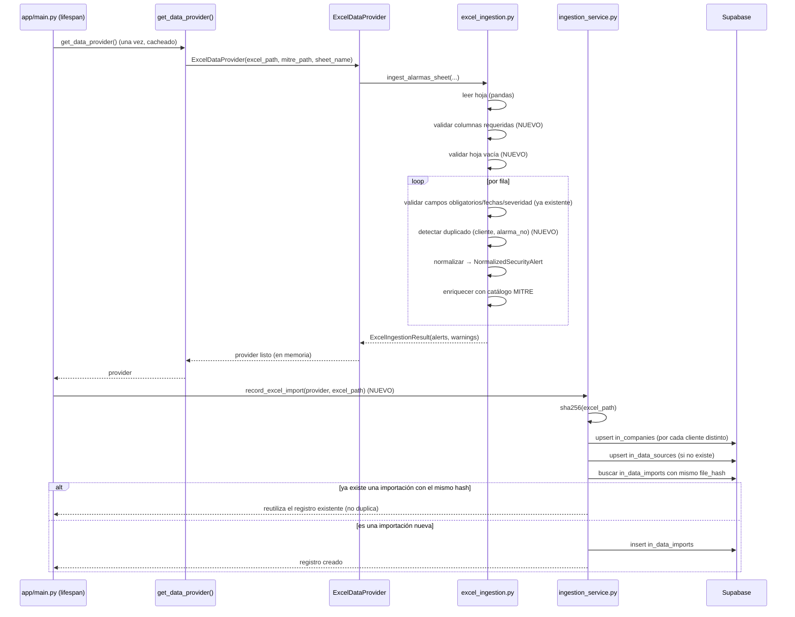

# INGESTION_ARCHITECTURE.md — Fase 3: Ingesta y normalización de datos

> Basado en [ARCHITECTURE_ASSESSMENT.md](ARCHITECTURE_ASSESSMENT.md) (Fase 0),
> [ARCHITECTURE_TARGET.md](ARCHITECTURE_TARGET.md) (Fase 1) y [DATA_MODEL.md](DATA_MODEL.md)
> (Fase 2). A diferencia de las fases anteriores, esta **sí implementa código** — el prompt maestro
> lo pide explícitamente ("Implementa únicamente después de revisar la arquitectura actual").

## Alcance de esta fase (qué se implementa y qué no)

Antes de tocar código: la Fase 0 ya encontró que `app/providers/excel_ingestion.py` +
`app/providers/excel.py` **ya implementan** la mayor parte del pipeline Conector → Parser →
Validador → Normalizador que pide esta fase — no se reescribe desde cero (regla: "no reemplaces
componentes funcionales sin justificarlo"). Lo que falta, concretamente, es:

1. **Persistencia de metadata de importación** — hoy no existe en absoluto (brecha explícita de la
   Fase 0/2).
2. **Tres validaciones que el prompt maestro pide explícitamente y hoy no existen**: columnas
   faltantes detectadas como un solo diagnóstico claro (hoy se diluyen en N advertencias por fila),
   hojas vacías, y registros duplicados dentro de una misma importación.
3. **El punto de extensión para una fuente JSON/API futura**, que el prompt maestro pide "preparado
   para futura integración" — es decir, diseñado y con el contrato explícito, no necesariamente una
   integración funcional contra un API real que todavía no existe.

Lo que **no** se hace en esta fase (para no sobreingeniería): no se persisten las alertas
normalizadas fila por fila (`in_security_alerts` de la Fase 2) — eso se decidió explícitamente
"Fase 4, no ahora" en `DATA_MODEL.md` y sigue así; esta fase solo necesita `in_companies`,
`in_data_sources` e `in_data_imports` para cumplir su propio requisito de "registrar metadata de
importación". No se construye un conector JSON/API funcional contra un servicio real — no existe
uno todavía y fabricar uno sería inventar un requisito.

## 1. Arquitectura de ingesta

El pipeline ya existente se formaliza en 6 etapas explícitas, mapeadas 1:1 al código:



**Etapas y su ubicación en código (ya existente, sin cambios de comportamiento salvo lo anotado):**

| Etapa | Módulo/función | Cambia en esta fase |
|---|---|---|
| Conector | `ExcelDataProvider.__init__` (`app/providers/excel.py`) | No — sigue construyendo el provider en memoria |
| Parser | `pd.read_excel(...)` dentro de `ingest_alarmas_sheet` | No |
| Validador | inline en `ingest_alarmas_sheet` (`app/providers/excel_ingestion.py`) | **Sí** — se agregan 3 validaciones nuevas (§4) |
| Normalizador | `_ingest_alarmas_dataframe` (nueva, extraída de `ingest_alarmas_sheet`) | Se extrae a función testeable, mismo comportamiento |
| Enriquecimiento | `load_mitre_catalog` + lookup por `mitre_tactic_id` | No |
| Persistencia | Ninguna hasta ahora | **Nueva:** `app/services/ingestion_service.py` registra metadata en Supabase (`in_companies`, `in_data_sources`, `in_data_imports`) |

**Dónde corre la etapa de persistencia:** el provider (`ExcelDataProvider`) se construye una sola
vez por proceso (`@lru_cache` en `factory.py`), de forma síncrona, dentro de una llamada que puede
ocurrir en medio de una request. Escribir a Supabase requiere I/O asíncrono, así que **no se hace
dentro del constructor del provider** — se agrega como un paso explícito en el `lifespan` de FastAPI
(`app/main.py`), ejecutado una vez al arrancar el backend, después de que el provider ya está
construido. Si Supabase no está disponible en ese momento, se registra una advertencia en el log y
**el backend sigue arrancando normalmente** — la metadata de importación es auditoría, no una
dependencia dura del camino de generación de informes (mantener el POC funcional tiene prioridad).

## 2. Contratos de datos

**El contrato de salida de cualquier conector no cambia**: `list[NormalizedSecurityAlert]` +
`warnings: list[str]` (hoy encapsulado en `ExcelIngestionResult`). Este es el contrato que la
Fase 0 ya identificó como el punto de extensión correcto, y se ratifica sin modificarlo — cualquier
fuente nueva (API JSON incluida) debe converger en el mismo shape.

Campos de `NormalizedSecurityAlert` confirmados contra los datos reales del cliente (no se ajustan
en esta fase — ya están validados por los 9 tests existentes de `test_excel_ingestion.py` y por el
uso real en producción del informe):

```
Identidad:       id, alarm_number, original_id (nullable), client
Clasificación:   alert_type, category, severity_score (nullable), risk_level, is_voided
Evento técnico:  event_timestamp, created_at, reported_at, source_ips[], external_ips[],
                 hostnames[], description, url (nullable)
MITRE ATT&CK:    mitre_tactic_id (nullable), mitre_tactic_name (nullable)
Registro SOC:    reported_by (PersonRef, nullable), authorized_by (PersonRef, nullable),
                 escalation (called/glpi_ticket/sharepoint_doc)
Resolución:      recommendations (nullable), response (nullable), responded_at (nullable), status
Trazabilidad:    raw_record (dict — la fila original completa, nunca descartada)
```

**Contrato nuevo de esta fase — metadata de importación** (lo que persiste
`ingestion_service.record_excel_import`, mapeado a `in_data_imports` de la Fase 2):

```
data_source_id, company_id, source_file_ref (nombre de archivo — no se sube el binario en
esta fase, ver §6), file_hash (sha256), status ("success" | "partial" | "failed"),
row_count, warning_count, warnings (jsonb), started_at, completed_at
```

`status = "partial"` cuando `warning_count > 0` pero se ingirió al menos una fila; `"failed"`
cuando la ingesta no produjo ninguna alerta; `"success"` cuando no hubo advertencias.

## 3. Flujo de procesamiento



El resto de la aplicación (`collect_data`, `security_tools`, el agente) **no cambia** — sigue
consultando `provider.get_security_alerts(...)` contra los datos ya en memoria, exactamente como
hoy. La persistencia de metadata es un efecto paralelo, no un paso en el camino crítico de generar
un informe.

## 4. Estrategia de validación

| Validación | Estado antes de esta fase | Estado después |
|---|---|---|
| Campos obligatorios (`id`, `cliente`) | ✅ Ya existía (fila se descarta con advertencia) | Sin cambios |
| Fechas (`timestamp`, `created_at`/`fecha_de_creacion_alarma`) | ✅ Ya existía | Sin cambios |
| Severidad (numérica o `"ANULADO"`) | ✅ Ya existía | Sin cambios |
| Tipos de alerta (`tipo`) | ⚠️ Se asumía `"Desconocido"` sin advertencia si faltaba | **Nuevo:** advertencia explícita cuando falta, mismo valor por defecto |
| Datos corruptos (severidad no parseable) | ✅ Ya existía | Sin cambios |
| **Registros duplicados** | ❌ No se detectaban | **Nuevo:** mismo `(cliente, alarma_no)` dentro de la misma hoja → se descarta la segunda ocurrencia con advertencia |
| **Hojas vacías** | ❌ Sin diagnóstico (devolvía lista vacía en silencio) | **Nuevo:** advertencia explícita "la hoja no contiene filas de datos" |
| **Columnas faltantes** | ❌ Se diluía en una advertencia por cada una de las 169 filas | **Nuevo:** un solo diagnóstico agregado, generado antes de procesar cualquier fila |

**Por qué "columnas faltantes" antes que las demás:** si falta una columna completa (ej. el cliente
renombra `"cliente"` a `"empresa"` en una versión futura del Excel), el código anterior producía
169 advertencias idénticas ("missing 'cliente'"), una por fila — técnicamente correcto pero inútil
para diagnosticar la causa real. La nueva validación revisa `df.columns` una sola vez, antes del
bucle, y devuelve un único mensaje agregado nombrando todas las columnas ausentes.

**Manejo de "diferentes versiones del Excel":** no se agrega un mecanismo de versionado de esquema
(sería sobreingeniería sin un segundo formato real que comparar) — la robustez existente ya cubre
la variación razonable: la lectura es por nombre de columna (no por posición), cada campo opcional
tolera ausencia sin fallar, y la nueva validación de columnas requeridas convierte un cambio
estructural mayor en un diagnóstico claro en vez de un fallo silencioso o 169 advertencias
redundantes.

## 5. Estrategia de errores

Se mantiene la distinción de tres niveles que el código ya usaba implícitamente, ahora explícita:

1. **Error de fila (recuperable):** falta un campo obligatorio, fecha no parseable, duplicado
   detectado → la fila se descarta, se registra una advertencia, **la ingesta continúa**. Esto no
   cambia en esta fase.
2. **Error de hoja (agregado, recuperable):** columnas requeridas ausentes, hoja vacía → se agrega
   una advertencia de nivel hoja (no de fila) y, en el caso de columnas ausentes, el bucle de filas
   se **omite por completo** (ya se sabe que cada fila fallaría de la misma forma — evita ruido).
3. **Error de infraestructura (Supabase no disponible al registrar metadata):** no debe impedir que
   el backend sirva requests — se captura, se loguea como advertencia, y el arranque continúa. La
   metadata de importación es trazabilidad, no un prerequisito funcional del pipeline de generación
   de informes (que sigue funcionando 100% en memoria, como hoy).

No se agregan reintentos automáticos ni backoff en esta fase — el registro de metadata ocurre una
vez al arrancar el proceso, y un reintento manual (reiniciar el backend) ya es suficiente al volumen
actual; se reconsiderará si la ingesta pasa a ser más frecuente (Fase 3 futura con API en tiempo
real).

## 6. Diseño para futuras APIs

El prompt maestro pide explícitamente que esto quede **preparado, no necesariamente implementado**
contra un servicio real. Se agrega el punto de extensión concreto sin inventar un API que no existe:

- **`app/providers/api.py` (nuevo):** una clase `ApiDataProvider(DataProvider)` que implementa el
  mismo contrato (`get_company`, `get_security_alerts`, etc.) pero cada método levanta
  `NotImplementedError` con un mensaje explícito señalando qué falta (endpoint, autenticación,
  mapeo de payload) — hace el punto de extensión tangible en el código, no solo en un documento, sin
  fabricar lógica de negocio contra un servicio inexistente.
- **`app/providers/factory.py`:** se agrega `DATA_PROVIDER=api` como opción reconocida (hoy solo
  `excel`/`mock`) — seleccionarla hoy falla con un error claro en vez de silenciosamente no hacer
  nada, dejando el "cableado" listo para cuando el conector real se implemente en una fase futura.
- **Cuando exista el API real, la implementación deberá:** (a) hacer el fetch HTTP/autenticación
  (fuera del alcance de `DataProvider` — vive en el conector, igual que `pd.read_excel` vive en
  `ExcelDataProvider`, no en el contrato), (b) mapear el JSON de respuesta a
  `NormalizedSecurityAlert` con el mismo rigor de validación que esta fase formalizó para Excel
  (campos obligatorios, fechas, duplicados), (c) reusar `ingestion_service.py` casi sin cambios
  para registrar la metadata de importación — su contrato (`data_source_id`, `file_hash` o
  equivalente, `warnings`) ya es agnóstico de si el origen fue un archivo o una respuesta HTTP (para
  un API, `file_hash` puede ser el hash del payload JSON recibido, o el rango de fechas + id de
  sincronización — se decide en la fase donde el API real exista, no aquí).
- **Config de la fuente:** `in_data_sources.config` (jsonb, ya diseñado en la Fase 2) es donde
  vivirá la URL base/parámetros de un API real — nunca credenciales en texto plano (regla ya fijada
  en `DATA_MODEL.md` §7).

---

**Fin de la Fase 3 (documento).** El código implementado a continuación en esta misma fase sigue
exactamente lo descrito arriba. Al finalizar, se corre la suite completa de tests antes de pedir
aprobación para la Fase 4.
