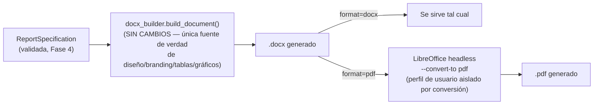

# REPORT_GENERATION_ARCHITECTURE.md — Fase 7: Generación profesional de DOCX y PDF

> Basado en [AGENT_ARCHITECTURE.md](AGENT_ARCHITECTURE.md) (Fase 4) y
> [DETERMINISTIC_FLOW.md](DETERMINISTIC_FLOW.md) (Fase 5). Implementada de punta a punta.
> 100/100 tests de backend (94 antes de esta fase + 6 nuevos), frontend sin errores de tipos.
> Esta fase, igual que la Fase 6, encontró y corrigió defectos reales durante su propia
> verificación en vivo — dos, esta vez (§6).

## 1. Arquitectura

La única pieza que faltaba del sistema de generación de documentos (Fase 0: "no hay PDF, solo
.docx") se resolvió con una decisión deliberada: **no construir un segundo renderizador**. En vez
de una implementación paralela en `reportlab` u otra librería PDF-nativa que tendría que replicar
cada tabla, gráfico, color de marca y regla de numeración ya implementada en `docx_builder.py`, el
PDF se obtiene **convirtiendo el mismo `.docx`** vía LibreOffice en modo headless.

**Por qué esta decisión y no una alternativa:**

| Alternativa | Por qué se descartó |
|---|---|
| Renderizador PDF paralelo (`reportlab`) | Duplicaría cada regla de layout/branding ya implementada; el DOCX y el PDF podrían divergir visualmente con el tiempo sin que nada lo detecte |
| `docx2pdf` (usa MS Word real) | Requiere Word instalado — no funciona en un servidor Linux/contenedor |
| Convertir vía LibreOffice headless (elegida) | El PDF **es** un render del mismo archivo — DOCX y PDF quedan garantizados idénticos visualmente, sin lógica nueva de layout |

Este es exactamente el mismo principio que ya guió toda la arquitectura desde la Fase 4: reutilizar
la única fuente de verdad en vez de construir un segundo camino paralelo.

## 2. Componentes

Sin cambios en `docx_builder.py` — sigue siendo el único lugar que sabe de branding, tablas,
gráficos (matplotlib), encabezados/pies de página y numeración. Lo nuevo es la capa que decide
**qué hacer con el archivo que produce**:

- **`DocumentService.render()`** (`app/services/report/document.py`, extendido): ahora acepta
  `format: "docx" | "pdf"`. Siempre construye el `.docx` primero (sigue siendo la única fuente de
  verdad); si se pidió PDF, lo convierte.
- **`_convert_to_pdf()`** (nueva, privada): invoca `soffice --headless --convert-to pdf`, con un
  perfil de usuario de LibreOffice **aislado y desechable por conversión**
  (`-env:UserInstallation=file://<tmp dir>`) — LibreOffice headless bloquea un perfil compartido por
  defecto, así que sin esto dos informes generados al mismo tiempo podrían bloquearse entre sí.
- **`DocumentGenerationError`** (nueva excepción): distingue un fallo de conversión (mensaje
  específico y accionable) de cualquier otro error — sigue el mismo principio de manejo de errores
  del resto del sistema (nunca un fallo silencioso ni un mensaje genérico cuando se puede ser
  específico).

## 3. Plantillas

Sin cambios sobre la Fase 4 — el `TemplateRegistry` (`app/services/report/templates.py`) ya
resolvía "sistema de plantillas configurable" y sigue teniendo una sola plantilla activa
(`csoc_mensual`). La generación de documento es ortogonal a la plantilla: cualquier plantilla nueva
que se registre en el futuro obtiene DOCX y PDF automáticamente, sin tocar `document.py`.

**Branding:** sigue siendo el de un único proveedor SOC (Invotecsa), codificado como constantes en
`docx_builder.py` — la Fase 0/1 ya identificó esto como una pregunta de negocio abierta ("¿cuántos
proveedores SOC debe soportar la plataforma?"), no una tarea técnica pendiente de esta fase.
Configurarlo por cliente sigue fuera de alcance mientras esa pregunta no tenga respuesta — hacerlo
ahora sería sobreingeniería sobre una necesidad hipotética.

## 4. Flujo de generación

Ambas modalidades (chat y formulario) ya pasaban por `DocumentService.render()` desde la Fase 4 —
esta fase solo le agrega un parámetro que ambas ya podían proveer:

- **Formulario:** el campo "Formato de salida" (Fase 5, antes deshabilitado con "PDF próximamente")
  ahora envía `format` real en el `ReportRequest`.
- **Chat:** se agregó `format` como campo extraíble por `understand_request` (mismo patrón que
  `audience`/`report_type`) — un usuario puede escribir "genera esto en PDF" y el sistema lo
  entiende, sin necesitar el formulario. Cambiar solo el formato **no** dispara una re-consulta de
  datos (no está en `refresh_fields`) — solo re-renderiza el documento ya construido.

## 5. Estrategia DOCX

Sin cambios — `python-docx` sigue siendo la única implementación, ya cubierta por
`test_docx_builder.py` desde antes de esta fase.

## 6. Estrategia PDF — y los dos defectos reales que su verificación encontró

La conversión funciona limpiamente (verificado con un PDF real de 13 páginas, branding, gráfico de
riesgo y tablas idénticos al `.docx`), pero **verificarla en vivo, no solo con mocks, encontró dos
problemas reales que ningún test unitario habría detectado**:

**(a) Falsa alarma que casi se investiga como bug.** `file <pdf>` reportó "31 pages" para un PDF que
`pdfinfo`/`pdftoppm` (herramientas reales de PDF) confirmaron que tiene 13 páginas — el conteo de
`file` (heurística de `libmagic`) no es confiable para PDFs. Antes de aceptar el número reportado,
se verificó con la herramienta correcta. Se documenta como advertencia metodológica: **nunca
confiar en el conteo de páginas de `file` para verificar un PDF**, usar `pdfinfo` o renderizar con
`pdftoppm`.

**(b) Defecto real: reenvío duplicado del formulario al generar un PDF.** Al generar un informe en
PDF desde el navegador (más lento que un `.docx` — build + conversión LibreOffice), la pestaña
pasó a segundo plano durante la espera. `@microsoft/fetch-event-source` (ya usado desde antes de
esta fase para el streaming SSE) **aborta la conexión activa cuando la pestaña se oculta y la
reabre — re-enviando el mismo `POST`— cuando vuelve a primer plano**, a menos que se le indique lo
contrario. Para un stream de chat esto podría ser razonable; para una generación de informe de un
solo disparo, significa **duplicar la generación completa del lado del servidor** sin que el
usuario lo pida. Se confirmó en Supabase: dos conversaciones, dos ejecuciones, dos pares
`.docx`/`.pdf` en disco por una sola pulsación de "Generar informe".

**Corrección:** `openWhenHidden: true` en ambas llamadas a `fetchEventSource` (`generateReport` y
`sendMessage`, `frontend/src/services/api.ts`) — ninguna de las dos es una suscripción que deba
reabrirse sola. Verificado repitiendo la generación en el navegador real: una sola conversación
creada, sin duplicados. Este defecto ya existía desde que se introdujo `fetchEventSource` (Fase 3
del chat original), pero solo se manifestó visiblemente ahora porque PDF es lo bastante lento como
para que backgrounding la pestaña durante la espera sea plausible — encontrarlo aquí, no antes, no
significa que sea privativo de PDF.

## 7. Manejo de errores

- **LibreOffice no instalado:** `DocumentGenerationError` con mensaje específico, sugiriendo pedir
  el `.docx` mientras tanto — no un fallo genérico.
- **Timeout de conversión** (60s): igual, mensaje específico.
- **`generate_document` falla dentro del grafo conversacional:** se corrigió `validate_document.py`
  para **no sobreescribir** un error específico ya registrado con el mensaje genérico "El documento
  no se generó correctamente" — antes de esta fase esa sobreescritura no importaba (solo existía un
  tipo de fallo posible); con la conversión a PDF como nueva fuente de error, perder el detalle
  específico sí importa.
- **Fallo inesperado en el flujo determinístico:** se agregó un `try/except` alrededor del consumo
  de `run_deterministic()` en `generate_report_deterministic` — sin esto, una excepción no prevista
  durante la conversión dejaría el stream SSE roto a medias en vez de terminar con un resultado de
  error limpio.

## 8. Versionamiento

Sin cambios de esquema — `in_report_versions.format` ya existía desde la Fase 2/5 (`"docx"` por
defecto), simplemente ahora se puebla con el valor real (`"docx"` o `"pdf"`) en vez de ser siempre
`"docx"`. El endpoint de descarga (`GET /api/reports/{id}/download`) ahora determina
`Content-Type`/extensión del archivo real en disco en vez de asumir `.docx` siempre — un informe
puede tener su v1 en `.docx` y su v2 en `.pdf` sin ninguna migración.

## 9. Infraestructura

`backend/Dockerfile` instala `libreoffice-writer` (no el paquete `libreoffice` completo, que
incluye Calc/Impress/Base innecesarios) — es la capa más pesada de la imagen; documentado
explícitamente como el punto a remover si un despliegue específico nunca necesita PDF.

## 10. Pruebas

- **`test_document_service.py`** (nuevo): dispatch de formato, error claro cuando `soffice` no está
  disponible (mockeado), y una prueba de generación de PDF real (con
  `@pytest.mark.skipif` si LibreOffice no está instalado en el entorno que corre los tests —
  mantiene la suite hermética en CI sin LibreOffice, pero da cobertura real donde sí está, como en
  este entorno de desarrollo).
- **`test_reports_api.py`**: reemplazados los tests que asumían "PDF rechazado" (correctos en la
  Fase 5, obsoletos ahora) por un test de generación-y-descarga de PDF real de punta a punta vía
  HTTP, más un test de formato genuinamente no soportado (`xlsx`).
- **Verificado en vivo, dos veces**: primero contra el backend real vía `curl` (PDF real de 13
  páginas, branding correcto, confirmado visualmente renderizando páginas a imagen), y después en
  el navegador real reproduciendo — y luego confirmando la corrección de — el bug de reenvío
  duplicado.

---

**Fin de la Fase 7.** Backend: 100/100 tests. Frontend: `tsc --noEmit` limpio, 4/4 tests. Quedo a la
espera de tu aprobación para iniciar la Fase 8 (calidad, testing y observabilidad).
